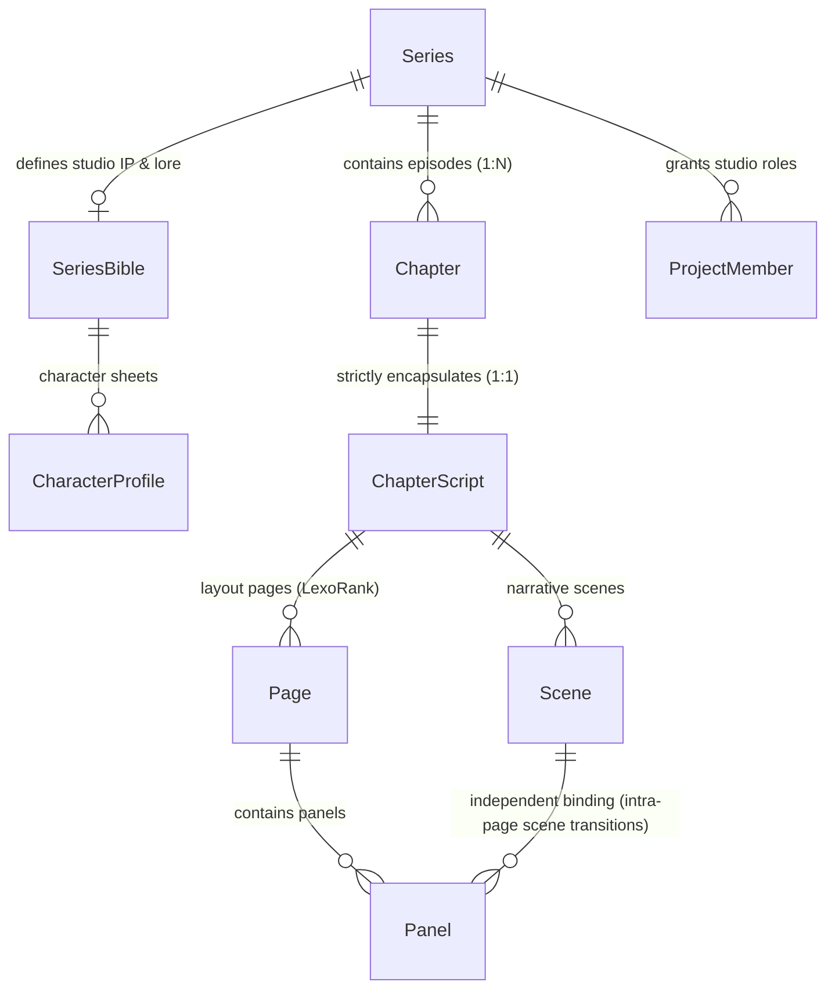
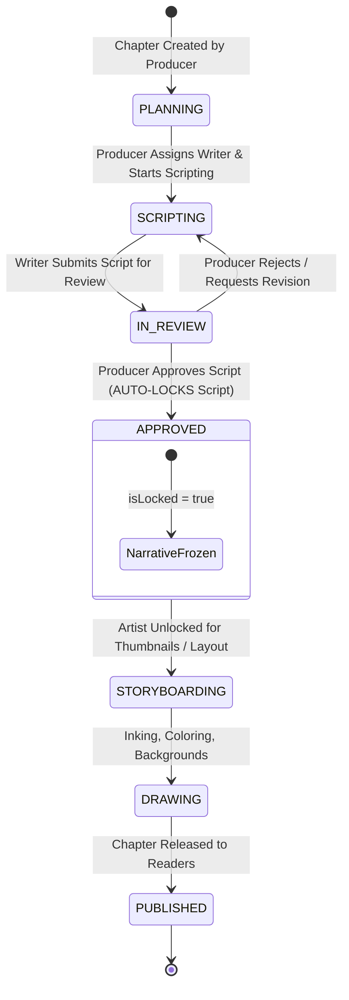
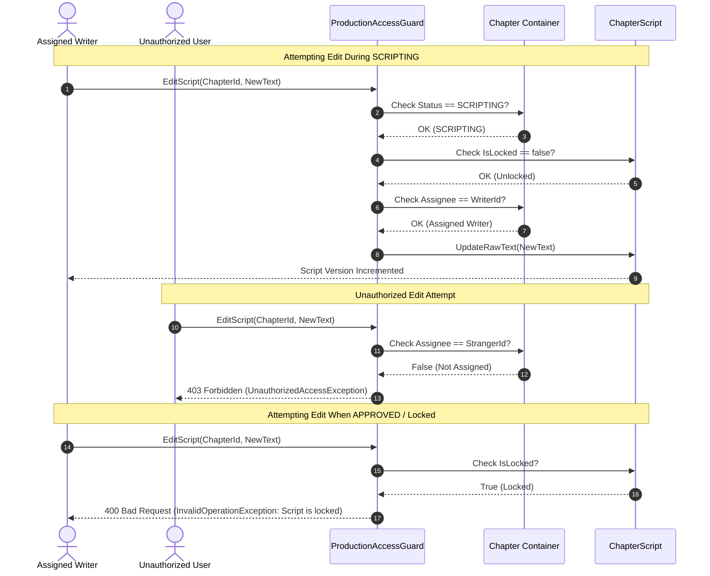

# PANELFORGE CORE PRODUCTION ARCHITECTURE SPECIFICATION
*(Manga / Webtoon Studio Collaborative Production Platform)*

> **Target Platform:** PanelForge Manga Production Platform (`SEP490_FA26SE251`)  
> **Core Architectural Paradigm:** Domain-Driven Design (Clean Architecture, CQRS) + Zero-Trust RBAC + Relational Content Container  
> **Key Domain Hierarchy:** `Series (Studio Level & Bible) ➔ Chapter (Production Container) ➔ Script (Dedicated Chapter Document)`

---

## 1. EXECUTIVE SUMMARY & DOMAIN MODEL HIERARCHY

The PanelForge production workflow is architectured around three clear jurisdictional boundaries:



### Jurisdictional Principles:
1. **Series (Studio Level)**:
   - Holds high-level Intellectual Property (IP), worldbuilding, character profiles, master plot outlines, and Series Bible entries.
   - **Does NOT** contain low-level, mutable production scripts.
2. **Chapter (Producer-Controlled Production Container)**:
   - Represents a single release/episode managed exclusively by the Producer.
   - Enforces scheduling (target release dates, deadlines, target panel counts [default 60], assignees: Writer, Artist).
   - Manages the chapter lifecycle state machine:
     `PLANNING` ➔ `SCRIPTING` ➔ `IN_REVIEW` ➔ `APPROVED` ➔ `STORYBOARDING` ➔ `DRAWING` ➔ `PUBLISHED`.
3. **Script (Writer-Authored Artifact - `ChapterScript`)**:
   - Strictly encapsulated **1:1** within its parent `Chapter`.
   - In `SCRIPTING` status: only assigned Writer (and Producer) can edit.
   - In `IN_REVIEW` status: edits are paused awaiting Producer review.
   - When Producer marks `APPROVED`: the script is **LOCKED** (`isLocked = true`, `lockedAt`, `lockedById`) to freeze the narrative baseline for the Artist's storyboard phase.
4. **Intra-Page Scene Transition**:
   - Panels reference scenes independently (`panel.sceneId`). A single physical/vertical page can seamlessly transition between scenes (e.g. Present ➔ Flashback ➔ Present).

---

## 2. PRODUCTION STATE MACHINE



### Transition Authority Matrix

| Source State | Target State | Authorized Role | Side Effects / Invariants |
|---|---|---|---|
| `PLANNING` | `SCRIPTING` | Producer | Sets Writer assignment active. Script editing unlocked. |
| `SCRIPTING` | `IN_REVIEW` | Assigned Writer / Producer | Writer submits script draft. Edits paused pending review. |
| `IN_REVIEW` | `SCRIPTING` | Producer | Producer revision request. Script remains mutable for Writer. |
| `IN_REVIEW` | `APPROVED` | Producer | **Freezes Narrative Baseline:** Script automatically locked (`isLocked = true`, `lockedAt = UtcNow`, `lockedById = ProducerId`). |
| `APPROVED` | `STORYBOARDING` | Producer | Artist starts thumbnailling/storyboarding against the immutable script baseline. |
| `STORYBOARDING` | `DRAWING` | Producer | Line art, inking, flats, and rendering underway. |
| `DRAWING` | `PUBLISHED` | Producer / Publisher | Chapter is published for public reader consumption. Terminal state. |

---

## 3. ZERO-TRUST RBAC & EDITING GAUNTLET



---

## 4. RELATIONAL DATABASE SPECIFICATION (POSTGRESQL & PRISMA)

```prisma
datasource db {
  provider = "postgresql"
  url      = env("DATABASE_URL")
}

enum ChapterStatus {
  PLANNING
  SCRIPTING
  IN_REVIEW
  APPROVED
  STORYBOARDING
  DRAWING
  PUBLISHED
}

enum RoleInProject {
  PRODUCER
  WRITER
  ARTIST
  EDITOR
}

model Series {
  id           String             @id @default(uuid())
  title        String
  description  String?            @db.Text
  createdAt    DateTime           @default(now())
  updatedAt    DateTime           @updatedAt
  
  bible        SeriesBible?
  chapters     Chapter[]
  members      ProjectMember[]

  @@map("series")
}

model SeriesBible {
  id           String             @id @default(uuid())
  seriesId     String             @unique
  series       Series             @relation(fields: [seriesId], references: [id], onDelete: Cascade)
  logline      String?
  synopsis     String?            @db.Text
  worldSetting String?            @db.Text
  characters   CharacterProfile[]
  createdAt    DateTime           @default(now())
  updatedAt    DateTime           @updatedAt

  @@map("series_bibles")
}

model CharacterProfile {
  id           String             @id @default(uuid())
  bibleId      String
  bible        SeriesBible        @relation(fields: [bibleId], references: [id], onDelete: Cascade)
  name         String
  role         String?
  bio          String?            @db.Text
  avatarUrl    String?
  colorTag     String?
  createdAt    DateTime           @default(now())
  updatedAt    DateTime           @updatedAt

  @@map("character_profiles")
}

model ProjectMember {
  id           String             @id @default(uuid())
  seriesId     String
  series       Series             @relation(fields: [seriesId], references: [id], onDelete: Cascade)
  userId       String
  role         RoleInProject
  createdAt    DateTime           @default(now())
  updatedAt    DateTime           @updatedAt

  @@unique([seriesId, userId])
  @@map("project_members")
}

model Chapter {
  id             String          @id @default(uuid())
  seriesId       String
  series         Series          @relation(fields: [seriesId], references: [id], onDelete: Cascade)
  chapterNumber  Int
  title          String?
  status         ChapterStatus   @default(PLANNING)
  deadline       DateTime?
  targetPanels   Int             @default(60)
  
  producerId     String
  writerId       String?
  artistId       String?
  
  script         ChapterScript?
  
  createdAt      DateTime        @default(now())
  updatedAt      DateTime        @updatedAt

  @@unique([seriesId, chapterNumber])
  @@index([seriesId, status])
  @@map("chapters")
}

model ChapterScript {
  id           String        @id @default(uuid())
  chapterId    String        @unique
  chapter      Chapter       @relation(fields: [chapterId], references: [id], onDelete: Cascade)
  version      Int           @default(1)
  rawText      String        @db.Text
  isLocked     Boolean       @default(false)
  lockedAt     DateTime?
  lockedById   String?
  
  scenes       Scene[]
  pages        Page[]

  createdAt    DateTime      @default(now())
  updatedAt    DateTime      @updatedAt

  @@map("chapter_scripts")
}

model Scene {
  id           String        @id @default(uuid())
  scriptId     String
  script       ChapterScript @relation(fields: [scriptId], references: [id], onDelete: Cascade)
  slugline     String
  orderIndex   Int
  isFlashback  Boolean       @default(false)
  panels       Panel[]
  createdAt    DateTime      @default(now())
  updatedAt    DateTime      @updatedAt

  @@index([scriptId, orderIndex])
  @@map("scenes")
}

model Page {
  id           String        @id @default(uuid())
  scriptId     String
  script       ChapterScript @relation(fields: [scriptId], references: [id], onDelete: Cascade)
  pageNumber   Int
  orderRank    String
  panels       Panel[]
  createdAt    DateTime      @default(now())
  updatedAt    DateTime      @updatedAt

  @@unique([scriptId, pageNumber])
  @@index([scriptId, orderRank])
  @@map("pages")
}

model Panel {
  id           String        @id @default(uuid())
  pageId       String
  page         Page          @relation(fields: [pageId], references: [id], onDelete: Cascade)
  sceneId      String
  scene        Scene         @relation(fields: [sceneId], references: [id], onDelete: Cascade)
  panelNumber  Int
  cameraShot   String?
  actionText   String        @db.Text
  isFlashback  Boolean       @default(false)
  dialogues    Json?
  sfx          Json?
  createdAt    DateTime      @default(now())
  updatedAt    DateTime      @updatedAt

  @@index([pageId, panelNumber])
  @@index([sceneId])
  @@map("panels")
}
```

---

## 5. INTRA-PAGE SCENE TRANSITION ARCHITECTURE

In traditional comic scripting, a Scene often forced a page break. In modern webtoon/manga vertical formats, **a single continuous canvas or page frequently transitions between scenes** (e.g., Ryu speaking in the rain at Shibuya, suddenly transitioning in panel 2 to a burning dojo flashback).

To model this accurately without corrupting layout order:
- `Page` belongs to `ChapterScript` and manages physical display coordinates and LexoRank order (`orderRank`).
- `Scene` belongs to `ChapterScript` and manages narrative location and mood (`slugline`, `isFlashback`).
- `Panel` belongs physically to `Page` (`pageId`), but **binds independently to `Scene` (`sceneId`)**.

### JSON AST Structure:
```json
{
  "pageNumber": 1,
  "orderRank": "0|hzzzzz:",
  "panels": [
    {
      "panelNumber": 1,
      "sceneId": "scene-present-shibuya",
      "cameraShot": "WIDE",
      "actionText": "Ryu stands under neon rain.",
      "isFlashback": false,
      "dialogues": [{ "character": "RYU", "text": "It started on that night..." }]
    },
    {
      "panelNumber": 2,
      "sceneId": "scene-flashback-dojo",
      "cameraShot": "CLOSE UP",
      "actionText": "The burning gate collapses in embers.",
      "isFlashback": true,
      "dialogues": [{ "character": "MASTER", "modifier": "(WHISPERING)", "text": "Never look back." }],
      "sfx": [{ "text": "CRACKLE" }]
    }
  ]
}
```
