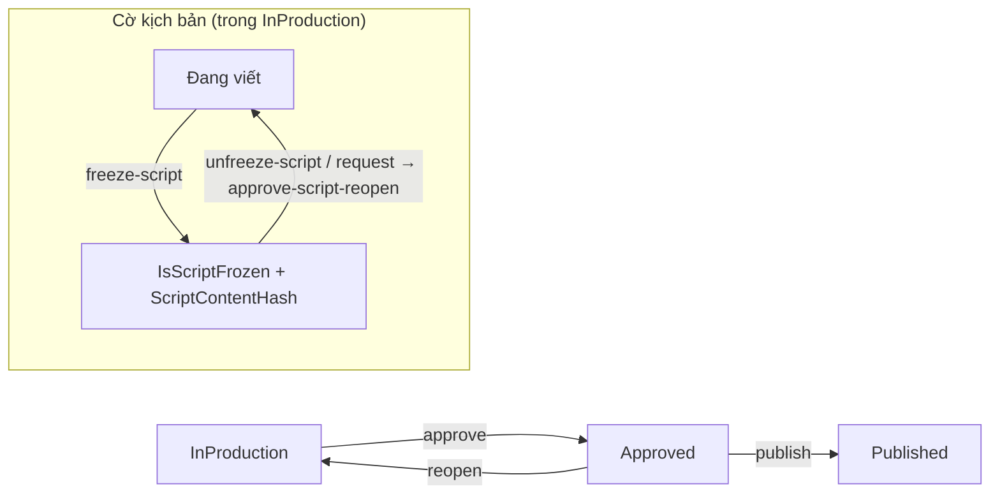

# TÀI LIỆU ĐẶC TẢ KIẾN TRÚC & TRIỂN KHAI: CHAPTER & SCRIPT MANAGEMENT

> **Dự án:** PanelForge Manga Production Platform (`SEP490_FA26SE251`)  
> **Kiến trúc áp dụng:** .NET 9 Clean Architecture + React 19 / TypeScript + Zero-Trust RBAC + Content-Addressed Storage (CAS SHA-256).  
> **Ngày cập nhật:** 03/11/2026.

---

## 1. TỔNG QUAN PHÂN HỆ CHAPTER & SCRIPT

Phân hệ **Chapter (Quản lý Chương)** và **Script (Biên kịch Kịch bản Manga)** đóng vai trò là "trái tim" trong giai đoạn tiền kỳ (Pre-production) của quy trình sản xuất truyện tranh Manga trên PanelForge:

1. **Chapter Management:** Thiết lập vòng đời chương truyện, tiến độ công đoạn (Pipeline Stages), ngày phát hành mục tiêu, và kiểm soát quyền hạn Zero-Trust giữa Producer và các thành viên sáng tác (Writer, Artist, Letterer, Editor).
2. **Script & Screenplay Flow:** Soạn thảo kịch bản phân cảnh manga chuyên dụng theo định dạng Screenplay chuẩn quốc tế (Page - Panel - Scene - Dialogue - Action - SFX), liên kết thực thể Series Bible (Nhân vật, Địa danh), đồng bộ hóa với Canvas Storyboard thông qua cơ chế `IntraPageSceneBinding`, và bảo vệ tính bất biến qua cơ chế Đóng băng kịch bản (`freeze-script`) kèm hash SHA-256.



---

## 2. KIẾN TRÚC BACKEND (.NET 9 CLEAN ARCHITECTURE)

> Mục 2 mô tả **đúng code hiện tại** (cập nhật 03/11/2026). Bản thiết kế cũ (enum 9 trạng thái DRAFT…ARCHIVED, `ChapterProductionStateMachine`, `ProductionAccessGuard`, API `/api/scripts/*`, `ContentJson`) đã bỏ: không khớp mô hình kịch bản theo script-lines và trùng với các gate đang có.

### 2.1. Domain Entities & Enums

#### 1. `Chapter` (`PanelForge.Domain.Entities.Content.Chapter`)
- `Id`, `SeriesId` (`Guid`). Workspace suy ra qua `Series.WorkspaceId`.
- `ChapterNumber` (`decimal`, > 0, cho phép chương lẻ như 10.5), `Title`, `TargetReleaseDate` (`DateOnly?`), `Outline`, `CoverImageSha256`, `VersionVector`.
- `Status` (`ChapterStatus`): `InProduction` → `Approved` → `Published` (`Approved` có thể `reopen` về `InProduction`).
- Đóng băng kịch bản: `IsScriptFrozen`, `ScriptFrozenAt`, `ScriptFrozenById`, **`ScriptContentHash`** (SHA-256 hex, null khi chưa đóng băng).
- Mở lại kịch bản có kiểm duyệt: `ScriptReopenStatus` (`None/Requested/Approved/Rejected`), `ScriptReopenReason`, `ScriptReopenRequestedById`, `ScriptReopenRequestedAt`.

#### 2. Kịch bản = `Scene` + `ScriptLine`
- Kịch bản không lưu thành một khối JSON mà theo dòng: `Scene` (`SceneNumber`, `Heading`, `Summary`) chứa nhiều `ScriptLine` (`LineOrder`, `SpeakerCharacterId`, `DialogueText`, `StageDirection`, `NarrationMode`, `PanelId?`).
- Mỗi lần sửa dòng tạo `ContentRevision` (append-only) → xem/khôi phục qua `script-revisions`.
- `ChapterScript` vẫn còn trong schema (bảng cũ) nhưng không có use case nào dùng.

### 2.2. Quy tắc nghiệp vụ

- **Tạo / sửa / xoá chương:** Producer của Series (kiểm server-side trong handler).
- **Sửa kịch bản:** Writer được giao (khi chương đã có Assignment Writer) hoặc Producer; bị chặn khi `IsScriptFrozen = true`.
- **Đóng băng (`freeze-script`, Producer):** chương phải `InProduction`, có ≥ 1 scene và ≥ 1 script-line, và qua **Chapter Bible Gate** (mọi mục Bible được tham chiếu phải có bản CanonLocked tại chương đó). Lúc đóng băng, hệ thống tính `ScriptContentHash` = SHA-256 của chuỗi chuẩn hoá các dòng (sắp theo `SceneNumber`, `LineOrder`; mỗi dòng `scene|line|speaker|narrationMode|dialogue|stageDirection`).
- **Mở lại:** Writer `request-script-reopen` (bắt buộc lý do) → Producer `approve`/`reject`; hoặc Producer `unfreeze-script` trực tiếp. Mở lại xoá `ScriptContentHash`.
- **Đóng băng lại sau khi mở:** Targeted Impact Analysis — Assignment / StageProgress của panel có dòng bị sửa sau thời điểm xin mở được gắn cờ `HasScriptImpact` (Assignment chuyển `ReworkRequired`); panel không đổi giữ nguyên.

### 2.3. Hợp đồng API (thực tế)

| Phương thức | Đường dẫn | Vai trò | Chức năng |
|---|---|---|---|
| `POST` | `/api/series/{seriesId}/chapters` | Producer | Tạo chương |
| `GET` | `/api/series/{seriesId}/chapters` | Thành viên | Danh sách chương |
| `GET` | `/api/chapters/{chapterId}` | Thành viên | Chi tiết chương |
| `PUT` | `/api/chapters/{chapterId}` | Producer | Sửa tiêu đề, ngày phát hành, outline |
| `DELETE` | `/api/chapters/{chapterId}` | Producer | Xoá chương |
| `GET` | `/api/chapters/{chapterId}/scenes` · `/api/scenes/{sceneId}` | Thành viên | Đọc kịch bản (scene + script-lines) |
| `POST/PUT/DELETE` | `/api/chapters/{chapterId}/…/script-lines…` | Writer được giao / Producer | Sửa kịch bản theo dòng |
| `POST` | `/api/chapters/{chapterId}/freeze-script` | Producer | Đóng băng + tính `ScriptContentHash` |
| `POST` | `/api/chapters/{chapterId}/unfreeze-script` | Producer | Mở khoá trực tiếp |
| `POST` | `/api/chapters/{chapterId}/request-script-reopen` | Writer | Xin mở lại (kèm lý do) |
| `POST` | `/api/chapters/{chapterId}/approve-script-reopen` · `reject-script-reopen` | Producer | Duyệt / từ chối |
| `POST` | `/api/chapters/{chapterId}/approve` · `reopen` · `publish` | Producer | Vòng đời chương |

Chi tiết DTO: xem `HANDOFF.md` và `docs/api/openapi.json`.

---

## 3. KIẾN TRÚC FRONTEND (REACT 19 + TYPESCRIPT)

### 3.1. Phân Rã Thành Phần (Component Architecture)

```
panelforge-fe/src/
├── roles/producer/
│   ├── modals/
│   │   ├── SeriesChaptersModal.tsx        # Modal Quản lý danh sách, thêm, sửa, xóa chương
│   │   └── SeriesChaptersModal.test.tsx   # Kiểm thử đơn vị giao diện quản lý chương
│   └── views/
│       ├── DashboardView.tsx              # Bảng điều khiển tiến độ tổng quan theo chương
│       └── DashboardView.test.tsx         # Kiểm thử bảo vệ không sập màn hình trắng
├── roles/writer/
│   ├── components/script/
│   │   ├── chapter-selection/
│   │   │   └── ChapterSelectionView.tsx   # Cổng chọn chương cho Writer (Gate Producer-only)
│   │   └── flow/
│   │       ├── ScreenplayFlowEditor.tsx   # Trình soạn thảo kịch bản Screenplay Flow
│   │       ├── scriptFlowAdapter.ts       # Chuyển đổi hai chiều giữa Data Model và Block Nodes
│   │       ├── types.ts                   # Định nghĩa Block Types (Page, Panel, Dialogue...)
│   │       └── nodes/
│   │           └── ScriptLineBlockNode.ts # BlockNode tùy biến với giao diện Screenplay
│   └── views/
│       ├── ScriptEditorView.tsx           # Màn hình chính tích hợp kịch bản, Bible Drawer, Thumbnail Studio
│       └── ScriptEditorView.test.tsx      # Kiểm thử quyền thao tác kịch bản
└── shared/
    └── components/
        ├── ErrorBoundary.tsx              # Lá chắn ngăn sập giao diện toàn ứng dụng
        ├── RouteFallback.tsx              # Spinner tải trang mượt mà
        └── TypeToConfirmModal.tsx         # Hộp thoại xác nhận gõ "DELETE" để xóa an toàn
```

### 3.2. Trình Soạn Thảo Screenplay Flow Manga (`ScreenplayFlowEditor.tsx`)

Trình soạn thảo Screenplay Flow được thiết kế riêng biệt cho việc sản xuất truyện tranh với các tính năng vượt trội:

1. **Khối phân trang & khung ảnh tự động (Page & Panel Hierarchy):**
   - Khối `page_heading` đại diện cho 1 trang truyện (`# Page 1`, `Trang 2`).
   - Khối `panel_heading` đại diện cho khung truyện. Trình biên tập tự động tính số thứ tự khung theo trang (`1.1`, `1.2`, `1.3`...) khi người dùng gõ phím hoặc thêm khối mới.
2. **Bảng công cụ phím tắt nổi (Floating Quick Palette):**
   - Thanh công cụ gắn bên phải màn hình cho phép chèn 1-chạm các khối chuẩn Manga:
     - `Trang (# Page)`: Ngắt trang mới.
     - `Khung (Panel)`: Thêm khung hình mới.
     - `Cảnh (Scene)`: Đặt bối cảnh (`INT./EXT. TRƯỜNG HỌC - NGÀY`).
     - `Lời thoại (Dialogue)`: Thoại nhân vật kèm auto-suggest tên nhân vật từ Series Bible.
     - `Hành động (Action)`: Mô tả cử chỉ nhân vật và góc nhìn.
     - `Hiệu ứng (SFX)`: Âm thanh truyện tranh (`BÙM!`, `XẸT!`).
     - `Chuyển cảnh (Transition)`: Cắt cảnh, mờ dần.
3. **Phím tắt Comic Markdown:**
   - Gõ `# Page 1` hoặc `Trang 1` và nhấn Enter $\rightarrow$ Tự động chuyển đổi thành khối Trang.
   - Gõ `Panel` hoặc `Khung` $\rightarrow$ Tự động đánh số thứ tự panel tiếp theo của trang hiện hành.
4. **Con trỏ Screenplay độ tương phản cao:**
   - Hiển thị con trỏ cam độ tương phản cao và hiệu ứng đánh dấu dòng đang nhập, tối ưu trải nghiệm gõ kịch bản tập trung (Writer Focus Mode).

### 3.3. Cơ Chế Chống Màn Hình Trắng & Phục Hồi Lỗi (Zero Blank-Screen Architecture)

- **Nguyên lý:** Mọi truy cập thuộc tính mảng/đối tượng từ API tiến độ đều có fallback an toàn (`progress?.chapters?.length`, `c.stages || []`, `progress.workload || []`, kiểm tra `!isNaN(new Date(dueDate).getTime())`).
- **`ErrorBoundary`:** Đặt tại tầng layout `AppShell` và gốc `App`. Khi xảy ra lỗi ngoại lệ, người dùng nhận được hộp thoại cảnh báo thân thiện hiển thị chi tiết lỗi kèm nút **"Tải lại trang"**, không bao giờ bị rơi vào màn hình trắng vô định.
- **`RouteFallback`:** Thay thế `fallback={null}` bằng biểu tượng đang tải rõ ràng, tránh cảm giác ứng dụng bị đơ khi tải component lười.

---

## 4. HƯỚNG DẪN THAO TÁC NGƯỜI DÙNG (USER GUIDE)

### 4.1. Cách Tạo & Quản Lý Chương
1. Đăng nhập với vai trò **Producer**.
2. Truy cập vào Dashboard bộ truyện: `/workspaces/{workspaceId}/series/{seriesId}/dashboard`.
3. Nhấp vào nút **"Quản lý chương (Duyệt)"** ở góc trên bên phải.
4. Nhập tiêu đề, số chương, ngày phát hành dự kiến và bấm **"Tạo chương"**.

### 4.2. Cách Xóa Chương An Toàn (Type-to-Confirm)
1. Trong modal **Quản lý chương**, tìm đến dòng chương muốn xóa.
2. Nhấp vào biểu tượng thùng rác màu đỏ (**Xóa chương**).
3. Hộp thoại xác nhận an toàn sẽ hiện lên. Người dùng bắt buộc phải gõ đúng chữ **`DELETE`** vào ô xác nhận để kích hoạt nút xóa. Điều này loại bỏ hoàn toàn rủi ro vô tình xóa nhầm dữ liệu chương đang sản xuất.
4. Tại giao diện soạn kịch bản (`ScriptEditorView`), Producer cũng có thể nhấn nút thùng rác trên thanh điều hướng để xóa chương hiện hành.

### 4.3. Cách Soạn Kịch Bản & Khóa Kịch Bản
1. Vào mục **Kịch bản (Script)** từ menu điều hướng.
2. Lựa chọn chương cần viết trong danh sách.
3. Sử dụng thanh công cụ bên phải hoặc gõ trực tiếp markdown để tạo cấu trúc Trang và Khung ảnh.
4. Hệ thống tự động lưu bản nháp theo cơ chế Debounce.
5. Khi hoàn tất và được Producer phê duyệt, kịch bản sẽ được chuyển sang trạng thái **Đóng băng (Frozen)** để bảo toàn nội dung, ngăn chặn việc sửa đổi kịch bản trong lúc họa sĩ đang vẽ Storyboard.

