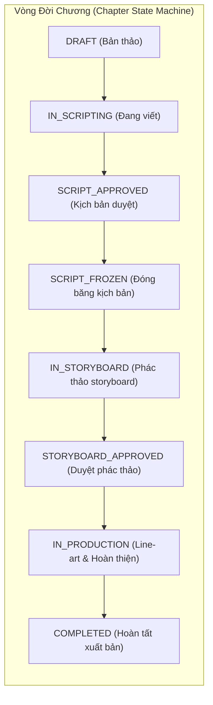

# TÀI LIỆU ĐẶC TẢ KIẾN TRÚC & TRIỂN KHAI: CHAPTER & SCRIPT MANAGEMENT

> **Dự án:** PanelForge Manga Production Platform (`SEP490_FA26SE251`)  
> **Kiến trúc áp dụng:** .NET 9 Clean Architecture + React 19 / TypeScript + Zero-Trust RBAC + Content-Addressed Storage (CAS SHA-256).  
> **Ngày cập nhật:** 03/11/2026.

---

## 1. TỔNG QUAN PHÂN HỆ CHAPTER & SCRIPT

Phân hệ **Chapter (Quản lý Chương)** và **Script (Biên kịch Kịch bản Manga)** đóng vai trò là "trái tim" trong giai đoạn tiền kỳ (Pre-production) của quy trình sản xuất truyện tranh Manga trên PanelForge:

1. **Chapter Management:** Thiết lập vòng đời chương truyện, tiến độ công đoạn (Pipeline Stages), ngày phát hành mục tiêu, và kiểm soát quyền hạn Zero-Trust giữa Producer và các thành viên sáng tác (Writer, Artist, Letterer, Editor).
2. **Script & Screenplay Flow:** Soạn thảo kịch bản phân cảnh manga chuyên dụng theo định dạng Screenplay chuẩn quốc tế (Page - Panel - Scene - Dialogue - Action - SFX), liên kết thực thể Series Bible (Nhân vật, Địa danh), đồng bộ hóa với Canvas Storyboard thông qua cơ chế `IntraPageSceneBinding`, và bảo vệ tính bất biến qua cơ chế Đóng băng kịch bản (`FreezeScript`).



---

## 2. KIẾN TRÚC BACKEND (.NET 9 CLEAN ARCHITECTURE)

### 2.1. Domain Entities & Enums

#### 1. `Chapter` (`PanelForge.Domain.Entities.Content.Chapter`)
- **Khóa chính:** `Id` (`Guid`).
- **Khóa ngoại:** `SeriesId` (`Guid`), `WorkspaceId` (`Guid`).
- **Thuộc tính tiến độ:**
  - `ChapterNumber` (`int`): Thứ tự chương (1, 2, 3...).
  - `Title` (`string`): Tiêu đề chương.
  - `TargetReleaseDate` (`DateTime?`): Hạn chót phát hành mục tiêu.
  - `Status` (`ProductionChapterStatus`): Trạng thái quy trình sản xuất.
  - `IsScriptFrozen` (`bool`): Cờ khóa kịch bản (ngăn chặn chỉnh sửa kịch bản khi đã bước sang công đoạn Storyboard/Lineart).
  - `PipelineStages` (`ICollection<ChapterStage>`): Danh sách công đoạn sản xuất (Scripting, Storyboard, LineArt, Lettering, Review).

#### 2. `ChapterScript` (`PanelForge.Domain.Entities.Content.ChapterScript`)
- **Thuộc tính phiên bản:**
  - `Id` (`Guid`): Định danh kịch bản.
  - `ChapterId` (`Guid`): Liên kết 1-1 hoặc 1-N (theo revision) với `Chapter`.
  - `Version` (`int`): Số phiên bản tăng dần (1, 2, 3...).
  - `ContentJson` (`string`): Cấu trúc khối Tiptap/BlockNote JSON phân cấp theo Page và Panel.
  - `RawText` (`string`): Nội dung văn bản thô hỗ trợ tìm kiếm toàn văn.
  - `ContentHash` (`string`): Mã băm SHA-256 nội dung để kiểm tra tính toàn vẹn (CAS - Content-Addressed Storage).
  - `IsFrozen` (`bool`): Trạng thái bất biến của phiên bản kịch bản.

#### 3. `ProductionChapterStatus` (`PanelForge.Domain.Enums.ProductionChapterStatus`)
Bao gồm các trạng thái: `DRAFT`, `IN_SCRIPTING`, `SCRIPT_APPROVED`, `SCRIPT_FROZEN`, `IN_STORYBOARD`, `STORYBOARD_APPROVED`, `IN_PRODUCTION`, `COMPLETED`, `ARCHIVED`.

### 2.2. Domain Services & Quy Tắc Nghiệp Vụ

#### 1. `ChapterProductionStateMachine`
- Quản lý việc chuyển đổi trạng thái hợp lệ giữa các bước trong quy trình.
- **Quy tắc bắt buộc:**
  - Không thể nhảy cóc từ `DRAFT` thẳng tới `IN_PRODUCTION` mà phải thông qua kiểm duyệt kịch bản (`SCRIPT_APPROVED`) và đóng băng kịch bản (`SCRIPT_FROZEN`).
  - Khi chương chuyển sang `IN_STORYBOARD`, hệ thống tự động kích hoạt cờ `IsScriptFrozen = true`.

#### 2. `ProductionAccessGuard` (Zero-Trust RBAC Gate)
- **Tạo và Xóa Chapter (`CreateChapter`, `DeleteChapter`):** Duy nhất người dùng có vai trò `Producer` hoặc `WorkspaceOwner` mới có quyền thực thi. Người dùng vai trò `Writer`, `Artist`, `Letterer`, `Editor` chỉ được xem hoặc nhận task phân công.
- **Biên kịch (`EditScript`):** Chỉ cho phép `Writer` được phân công và `Producer`. Nếu `IsScriptFrozen == true`, mọi vai trò (kể cả Producer) đều bị từ chối sửa nội dung trừ khi thực hiện thao tác mở khóa kịch bản đặc quyền (`UnfreezeScriptCommand`).

### 2.3. Hợp Đồng API RESTful (API Contracts)

| Phương thức | Đường dẫn API | Vai trò tối thiểu | Chức năng |
|---|---|---|---|
| `POST` | `/api/chapters` | **Producer** | Tạo mới chương truyện trong Series |
| `GET` | `/api/chapters/series/{seriesId}` | Thành viên Workspace | Lấy danh sách chương (hỗ trợ phân trang) |
| `GET` | `/api/chapters/{id}` | Thành viên Workspace | Lấy thông tin chi tiết của 1 chương |
| `PUT` | `/api/chapters/{id}` | **Producer** | Cập nhật tiêu đề, số chương, ngày phát hành mục tiêu |
| `DELETE` | `/api/chapters/{id}` | **Producer** | Xóa chương (Yêu cầu xác nhận xóa) |
| `GET` | `/api/scripts/{chapterId}` | Thành viên Workspace | Lấy phiên bản kịch bản hiện tại |
| `POST` | `/api/scripts/{chapterId}` | Writer / Producer | Lưu bản thảo kịch bản (Draft Auto-save) |
| `POST` | `/api/scripts/{chapterId}/freeze` | **Producer** / Editor | Đóng băng kịch bản chuyển giao Storyboard |
| `POST` | `/api/scripts/{chapterId}/unfreeze`| **Producer** | Mở khóa khẩn cấp kịch bản |

---

## 3. KIẾN TRÚC FRONTEND (REACT 19 + TYPESCRIPT)

### 3.1. Phân Rã Thành Phần (Component Architecture)

```
panelforge-fe/src/
├── roles/producer/
│   ├── modals/
│   │   ├── SeriesChaptersModal.tsx        # Modal Quản lý danh sách, thêm, sửa, xóa chương
│   │   └── SeriesChaptersModal.test.tsx   # Kiểm thử đơn vị giao diện quản lý chương
│   └── views/
│       ├── DashboardView.tsx              # Bảng điều khiển tiến độ tổng quan theo chương
│       └── DashboardView.test.tsx         # Kiểm thử bảo vệ không sập màn hình trắng
├── roles/writer/
│   ├── components/script/
│   │   ├── chapter-selection/
│   │   │   └── ChapterSelectionView.tsx   # Cổng chọn chương cho Writer (Gate Producer-only)
│   │   └── flow/
│   │       ├── ScreenplayFlowEditor.tsx   # Trình soạn thảo kịch bản Screenplay Flow
│   │       ├── scriptFlowAdapter.ts       # Chuyển đổi hai chiều giữa Data Model và Block Nodes
│   │       ├── types.ts                   # Định nghĩa Block Types (Page, Panel, Dialogue...)
│   │       └── nodes/
│   │           └── ScriptLineBlockNode.ts # BlockNode tùy biến với giao diện Screenplay
│   └── views/
│       ├── ScriptEditorView.tsx           # Màn hình chính tích hợp kịch bản, Bible Drawer, Thumbnail Studio
│       └── ScriptEditorView.test.tsx      # Kiểm thử quyền thao tác kịch bản
└── shared/
    └── components/
        ├── ErrorBoundary.tsx              # Lá chắn ngăn sập giao diện toàn ứng dụng
        ├── RouteFallback.tsx              # Spinner tải trang mượt mà
        └── TypeToConfirmModal.tsx         # Hộp thoại xác nhận gõ "DELETE" để xóa an toàn
```

### 3.2. Trình Soạn Thảo Screenplay Flow Manga (`ScreenplayFlowEditor.tsx`)

Trình soạn thảo Screenplay Flow được thiết kế riêng biệt cho việc sản xuất truyện tranh với các tính năng vượt trội:

1. **Khối phân trang & khung ảnh tự động (Page & Panel Hierarchy):**
   - Khối `page_heading` đại diện cho 1 trang truyện (`# Page 1`, `Trang 2`).
   - Khối `panel_heading` đại diện cho khung truyện. Trình biên tập tự động tính số thứ tự khung theo trang (`1.1`, `1.2`, `1.3`...) khi người dùng gõ phím hoặc thêm khối mới.
2. **Bảng công cụ phím tắt nổi (Floating Quick Palette):**
   - Thanh công cụ gắn bên phải màn hình cho phép chèn 1-chạm các khối chuẩn Manga:
     - `Trang (# Page)`: Ngắt trang mới.
     - `Khung (Panel)`: Thêm khung hình mới.
     - `Cảnh (Scene)`: Đặt bối cảnh (`INT./EXT. TRƯỜNG HỌC - NGÀY`).
     - `Lời thoại (Dialogue)`: Thoại nhân vật kèm auto-suggest tên nhân vật từ Series Bible.
     - `Hành động (Action)`: Mô tả cử chỉ nhân vật và góc nhìn.
     - `Hiệu ứng (SFX)`: Âm thanh truyện tranh (`BÙM!`, `XẸT!`).
     - `Chuyển cảnh (Transition)`: Cắt cảnh, mờ dần.
3. **Phím tắt Comic Markdown:**
   - Gõ `# Page 1` hoặc `Trang 1` và nhấn Enter $\rightarrow$ Tự động chuyển đổi thành khối Trang.
   - Gõ `Panel` hoặc `Khung` $\rightarrow$ Tự động đánh số thứ tự panel tiếp theo của trang hiện hành.
4. **Con trỏ Screenplay độ tương phản cao:**
   - Hiển thị con trỏ cam độ tương phản cao và hiệu ứng đánh dấu dòng đang nhập, tối ưu trải nghiệm gõ kịch bản tập trung (Writer Focus Mode).

### 3.3. Cơ Chế Chống Màn Hình Trắng & Phục Hồi Lỗi (Zero Blank-Screen Architecture)

- **Nguyên lý:** Mọi truy cập thuộc tính mảng/đối tượng từ API tiến độ đều có fallback an toàn (`progress?.chapters?.length`, `c.stages || []`, `progress.workload || []`, kiểm tra `!isNaN(new Date(dueDate).getTime())`).
- **`ErrorBoundary`:** Đặt tại tầng layout `AppShell` và gốc `App`. Khi xảy ra lỗi ngoại lệ, người dùng nhận được hộp thoại cảnh báo thân thiện hiển thị chi tiết lỗi kèm nút **"Tải lại trang"**, không bao giờ bị rơi vào màn hình trắng vô định.
- **`RouteFallback`:** Thay thế `fallback={null}` bằng biểu tượng đang tải rõ ràng, tránh cảm giác ứng dụng bị đơ khi tải component lười.

---

## 4. HƯỚNG DẪN THAO TÁC NGƯỜI DÙNG (USER GUIDE)

### 4.1. Cách Tạo & Quản Lý Chương
1. Đăng nhập với vai trò **Producer**.
2. Truy cập vào Dashboard bộ truyện: `/workspaces/{workspaceId}/series/{seriesId}/dashboard`.
3. Nhấp vào nút **"Quản lý chương (Duyệt)"** ở góc trên bên phải.
4. Nhập tiêu đề, số chương, ngày phát hành dự kiến và bấm **"Tạo chương"**.

### 4.2. Cách Xóa Chương An Toàn (Type-to-Confirm)
1. Trong modal **Quản lý chương**, tìm đến dòng chương muốn xóa.
2. Nhấp vào biểu tượng thùng rác màu đỏ (**Xóa chương**).
3. Hộp thoại xác nhận an toàn sẽ hiện lên. Người dùng bắt buộc phải gõ đúng chữ **`DELETE`** vào ô xác nhận để kích hoạt nút xóa. Điều này loại bỏ hoàn toàn rủi ro vô tình xóa nhầm dữ liệu chương đang sản xuất.
4. Tại giao diện soạn kịch bản (`ScriptEditorView`), Producer cũng có thể nhấn nút thùng rác trên thanh điều hướng để xóa chương hiện hành.

### 4.3. Cách Soạn Kịch Bản & Khóa Kịch Bản
1. Vào mục **Kịch bản (Script)** từ menu điều hướng.
2. Lựa chọn chương cần viết trong danh sách.
3. Sử dụng thanh công cụ bên phải hoặc gõ trực tiếp markdown để tạo cấu trúc Trang và Khung ảnh.
4. Hệ thống tự động lưu bản nháp theo cơ chế Debounce.
5. Khi hoàn tất và được Producer phê duyệt, kịch bản sẽ được chuyển sang trạng thái **Đóng băng (Frozen)** để bảo toàn nội dung, ngăn chặn việc sửa đổi kịch bản trong lúc họa sĩ đang vẽ Storyboard.

