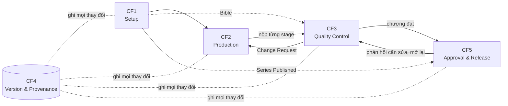
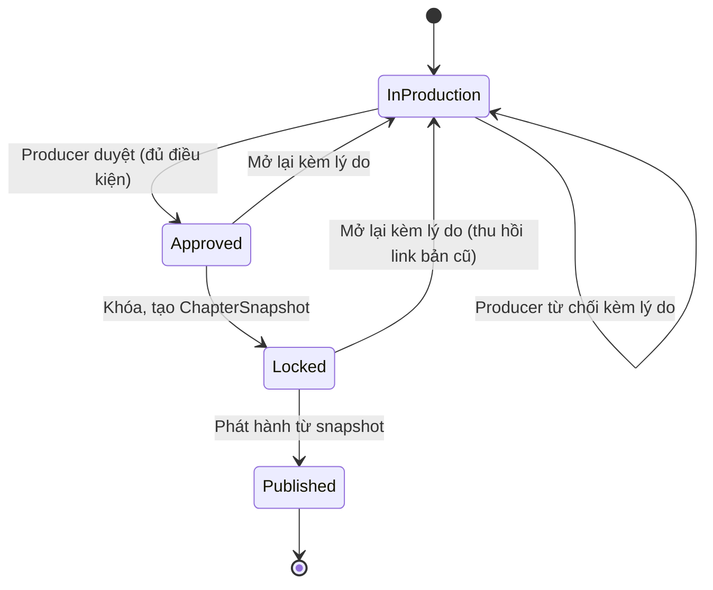
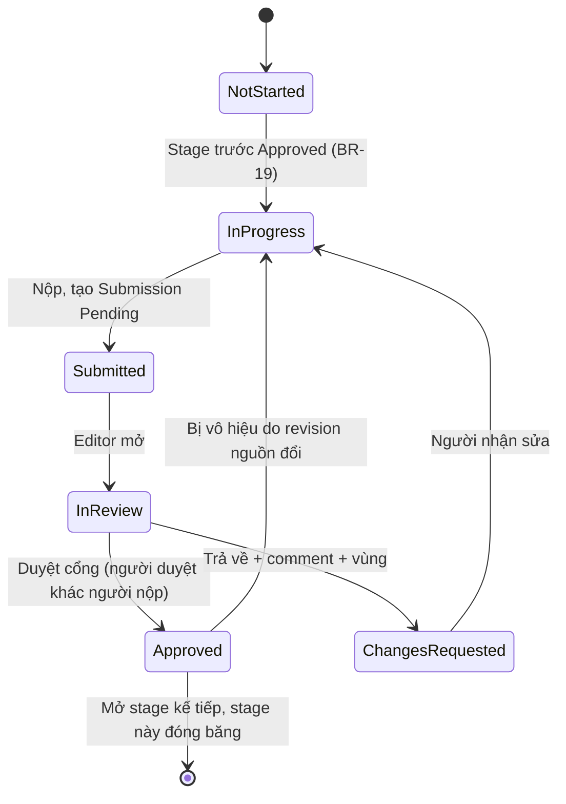
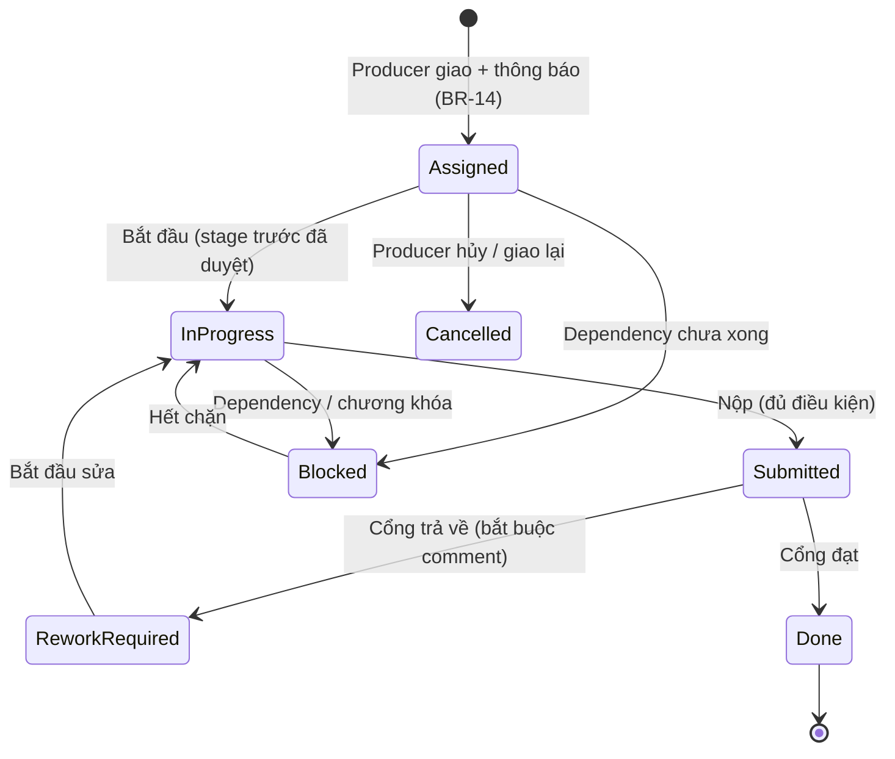

# PanelForge: 5 Core Flow

> **Phiên bản:** 2.1 (06/10/2026). Đối chiếu lại với phiếu đăng ký V1.2 (`docs/reports/GFA26SE140_Phieu_FA26SE251_JapanComicWorkflow_V1.2.docx`, các dòng Record of Changes ngày 02/10 và 06/10/2026). Phần đổi so với 2.0 gắn nhãn **[Chốt theo phiếu V1.2]**
> **Nguồn gốc:** mục 10 "Core Flows" của [`PanelForge_Capstone_Content.md`](PanelForge_Capstone_Content.md), cập nhật theo các tài liệu đã sửa ngày 04/10/2026:
> [`panelforge-design-research.md`](../research/panelforge-design-research.md), [`consistency-design.md`](../research/consistency-design.md), [`manga-consistency-research.md`](../research/manga-consistency-research.md), [`manga-production-collaboration-research.md`](../research/manga-production-collaboration-research.md), [`series-bible.md`](../domain/series-bible.md), [`glossary-and-rules.md`](glossary-and-rules.md).

**Cách đọc nhãn**

| Nhãn | Nghĩa |
|---|---|
| *(không nhãn)* | Có trong spec gốc (BR, UC, FR, NFR). Đây là phần bắt buộc |
| **[Đề xuất]** | Quyết định rút ra từ research, **chưa** có trong spec. Cần chốt với nhóm và giảng viên trước khi coi là yêu cầu |
| **[Chờ xác nhận]** | Spec ghi "to be confirmed" hoặc research nêu là cần phỏng vấn |
| **[Chốt theo phiếu V1.2]** | Nhóm đã chốt trong phiếu đăng ký đề tài V1.2. Riêng các giá trị nghiệm thu (timeout 30 giây, precision/recall tối thiểu 70%, ngưỡng tương đồng 0.75, Task Success Rate 80%) phiếu ghi là **đề xuất, chờ giảng viên xác nhận** |

---

## 0. Tổng quan

| Flow | Tên | Một câu | Role chính |
|---|---|---|---|
| **CF1** | Studio, Series & Series Bible Setup | Dựng môi trường làm việc (có giới hạn tài nguyên theo Workspace) và nền móng của Series, gồm Bible và character sheet khoá | Admin, Producer |
| **CF2** | Chapter Production | Biến việc được giao thành script, layout, artwork, lettering; mỗi Page/Panel chạy song song | Producer, Writer, Artist, Letterer |
| **CF3** | Quality Control | Duyệt theo vùng và phiên bản, kiểm tra nhất quán nhân vật (văn bản, luật bằng code, hình ảnh) với Bible, theo dõi Change Request | Editor |
| **CF4** | Version Control & Provenance *(xương sống)* | Mọi thay đổi là event append-only; khôi phục và truy vết AI | Tự động; Producer, Writer |
| **CF5** | Approval, Release & Export | Duyệt, khóa, xem thử, nhận phản hồi, xuất, phát hành hoặc mở lại | Producer, Editor, Reader |

**Ba nguyên tắc xuyên suốt**

1. **Hoàn thành ≠ duyệt ≠ chuyển stage ≠ khóa ≠ phát hành.** Mỗi việc do một người khác nhau quyết định và có trạng thái riêng (mục 6).
2. **Mọi phê duyệt gắn với một revision cụ thể.** Khi revision nguồn đổi, chỉ phê duyệt trong phạm vi bị ảnh hưởng mất hiệu lực, không phải cả chương **[Đề xuất]**.
3. **AI chỉ đề xuất, người quyết định, mọi thứ đều có bằng chứng** (BR-02, BR-10, BR-21).

---

## 1. CF1: Studio, Series & Series Bible Setup

**Mục tiêu.** Dựng môi trường (tài khoản, Workspace, quyền, cấu hình AI) và nền của Series (pipeline, lịch phát hành, Series Bible phiên bản hóa theo chương) mà mọi flow sau dựa vào.

**Actor.** Administrator; User (ứng viên chủ Studio, thành Producer khi Studio tồn tại). Hệ thống ngoài: AI Provider (chỉ cấu hình, chưa gọi).

**Luồng chính**

| # | Bước | Quy tắc |
|---|---|---|
| 1 | User đăng nhập; hệ thống đọc `SystemRole` (Administrator / User) và điều hướng | UC-01 |
| 2 | **Administrator**: vào Admin dashboard, quản lý tài khoản, cấp/thu quyền `CanCreateStudio`, cấu hình AI provider, model, bật/tắt và quota token hằng tháng theo Workspace; **đặt luật cho từng Workspace**: dung lượng lưu trữ (GB), quota sinh ảnh (số ảnh hoặc ngân sách, vì token LLM không phản ánh chi phí mô hình ảnh), session policy (thời gian sống, idle timeout, số phiên đồng thời); cấu hình retention và lịch backup; quản lý master data; xem audit log và usage từng Workspace **[Chốt theo phiếu V1.2]** | UC-02, UC-15, BR-22, NFR Workspace Resource Governance |
| 3 | **User có `CanCreateStudio = true`**: tạo Workspace (Studio); hệ thống tự thêm dòng `workspace_members` với role `Producer` cho người tạo | BR-22 |
| 4 | **User không có quyền tạo Studio** hoặc thành viên được mời: vào "Your Workspaces", chỉ thấy Studio có dòng `workspace_members` của mình. Không thuộc Studio nào thì thấy catalog công khai các Series đã `Published` | BR-23 |
| 5 | Producer tạo Series: thể loại, định dạng, **hướng đọc** (RTL/LTR), pipeline stage, lịch phát hành; ghi **synopsis và story arc** của Series (Writer dựa vào đó lập chapter outline ở CF2) | UC-03 |
| 6 | Producer mời thành viên; mỗi lời mời tạo một dòng `workspace_members` mang `WorkspaceRole` (Producer, Writer, Artist, Letterer, Editor) cho riêng Workspace đó | BR-07 |
| 7 | **Hợp tác sản xuất Series Bible (Writer ↔ Artist ↔ Producer)**: Mỗi mục là `BibleEntry`, phiên bản hóa qua `BibleEntryRevision` có **chương bắt đầu hiệu lực** (hỗ trợ nhân vật lúc nhỏ Ch.1 và lúc lớn Ch.15). Áp dụng **Vòng đời kiểm duyệt 2 tầng**: (1) Writer khởi tạo đặc tả (`Draft / Specifying`), (2) Artist nhận việc qua **Bible Design Queue** để vẽ và tải Character Sheet lên kho Asset CAS SHA-256 (`ConceptSubmitted`, ghi nhận `ArtistUserId`), (3) Writer/Editor đối chiếu nguyên tác (`ReworkRequired` kèm phản hồi hoặc `WriterEndorsed`), (4) Producer phê duyệt và chốt khóa canon (`🔒 CanonLocked`). Bản đã khóa tuyệt đối không mở khóa; muốn thay đổi bắt buộc dùng `/supersede` tạo revision mới. | UC-04, BR-15, V2.5 |
| 8 | Producer bật consistency rule và typography preset cho Series | NFR-08 |
| 9 | Hệ thống ghi phiên bản đầu của mọi mục kèm người tạo và thời điểm | BR-18 |
| 10 | Administrator xem audit log, báo cáo AI usage và usage storage, token AI, sinh ảnh của từng Workspace bất kỳ lúc nào; Producer xem **màn hình usage** của Studio mình (storage, token AI, ảnh, session so với giới hạn) **[Chốt theo phiếu V1.2]** | UC-15 |
| 11 | Series sẵn sàng cho Writer sáng tác tiền kỳ và Artist chuẩn bị tài nguyên | |

**Cập nhật từ research & Kiến trúc V2.5**

- **Vòng đời kiểm duyệt Series Bible 2 tầng [V2.5].** Thay vì chỉ có cờ `isLocked`, mỗi revision trải qua máy trạng thái chuẩn: `Draft` (Writer đặc tả) ➔ `ConceptSubmitted` (Artist tải Concept Art / Model Sheet) ➔ `ReworkRequired` (Writer/Editor yêu cầu sửa) ➔ `WriterEndorsed` (Writer/Editor xác nhận khớp cốt truyện) ➔ `CanonLocked` (Producer chốt khóa canon). Cấp quyền cho role `Artist` tham gia thiết kế và tải Asset CAS SHA-256 vào Series Bible.
- **Hàng đợi thiết kế Bible cho Artist (Bible Design Queue) [V2.5].** Artist theo dõi danh sách mục Bible cần vẽ (`Pending Concept Art / Rework`) trực tiếp từ Series Bible và dashboard mà không cần Producer tạo Assignment chương.
- **Bible tách ba tầng sự thật [Đề xuất].** Sự thật của thế giới, nhân vật biết (`knownBy`: nhân vật → từ chương), độc giả biết (`revealedToReaderFromChapter`). MVP lưu trong `DetailsJson`. *Nguồn: `consistency-design.md` 3.3.*
- **Không có `SeriesMember`.** MVP giới hạn phạm vi làm việc bằng **Assignment** (CF2), không thêm bảng thành viên theo Series. *Nguồn: design-research M1.*
- **Một người nhiều role [Đề xuất].** Cho phép một User có nhiều dòng role trong cùng Workspace (mangaka thường vừa viết vừa vẽ). Đi kèm quy tắc tách vai: không tự duyệt bài mình nộp (CF3). *Nguồn: design-research M11, collaboration-research 1.4.*
- **Ai chia trang/panel [Đề xuất & V2.5].** Writer chỉ tập trung vào cây tự sự thuần túy (`Story Arc -> Chapter Outline -> Scene -> ScriptLine`); Artist chia trang/khung tranh trong giai đoạn Thumbnail/Layout (hoặc có sự hỗ trợ của Storyboard Agent). Writer không bị bắt buộc chia Page hay Panel.
- **Admin không có truy cập khẩn cấp vào nội dung** trong MVP. *Nguồn: design-research M16 (spec ghi "to be confirmed").*
- **Character sheet khoá, versioned theo chương [Chốt theo phiếu V1.2].** Sheet gồm sketch hành động, cảm xúc, chuyển động do Artist upload cùng tính cách, cách nói, phong cách vẽ và chế độ màu (lõi là trắng đen, màu là mở rộng). Phiên bản mới có hiệu lực từ chương được chọn; sau khi khoá chỉ thay được bằng phiên bản mới, không sửa. Agent và các kiểm tra luôn đọc phiên bản đang hiệu lực ở chương đang làm. Nền tảng vẫn dùng được khi không có sinh ảnh: khoá sheet, kiểm tra nhất quán và upload thủ công không phụ thuộc sinh ảnh.
- **Bible là bộ nhớ có phiên bản của AI agent [Chốt theo phiếu V1.2].** Các mục thuộc revision đang hiệu lực ở chương được đưa vào ngữ cảnh agent qua truy vấn có cấu trúc. Truy hồi vector chỉ thêm khi ngữ cảnh vượt ngân sách của mô hình (ngưỡng thống nhất với giảng viên).
- **Giới hạn được kiểm trước khi thực hiện thao tác [Chốt theo phiếu V1.2].** Mỗi giới hạn Workspace (upload, gọi AI, sinh ảnh, đăng nhập hoặc làm mới token) được kiểm tại điểm sử dụng; vượt giới hạn trả lỗi rõ ràng, không lỗi ngầm và không chi phí vô hạn. Admin và Producer đều xem được mức dùng.
- **Synopsis, story arc, chapter outline [Chốt theo phiếu V1.2].** Producer hoặc Writer ghi synopsis và story arc của Series; Writer lập outline từng chương ở CF2.

**Kết quả.** Studio có thành viên đúng quyền, pipeline, lịch phát hành và Bible phiên bản đầu, sẵn sàng cho CF2. Administrator không có dòng `workspace_members` ở Studio nào và không tạo nội dung.

**Ngoại lệ**

- Không có dòng `workspace_members` → không truy cập Workspace và Series của nó (BR-07, BR-23).
- User không có `CanCreateStudio` không tạo được Studio (BR-22).
- Mục Bible không bao giờ bị ghi đè; sửa ngược là revision mới hiệu lực từ chương sớm hơn (BR-01, BR-15).
- Cấu hình AI sai hoặc hết quota: tắt tính năng AI, Series vẫn hoạt động, đường thủ công vẫn chạy (NFR-03).
- Vượt dung lượng, quota token hoặc quota ảnh, hoặc vượt số phiên đồng thời: thao tác bị từ chối kèm thông báo nêu giới hạn nào đã vượt; phần còn lại của Workspace vẫn dùng được.
- Pipeline, element type, preset, consistency rule sửa được mà không cần deploy lại (NFR-08).

**Liên kết.** Cấp cho CF2 (pipeline, kịch bản, Bible), CF3 (Bible để kiểm tra), CF5 (Series `Published` vào catalog công khai).

---

## 2. CF2: Chapter Production

**Mục tiêu.** Biến kịch bản đã duyệt và tài nguyên Bible thành nội dung hoàn chỉnh: layout, artwork, lettering. Mỗi Page/Panel đi qua stage của nó **độc lập**, nên các Page được sản xuất song song.

**Actor.** Producer, Writer, Artist, Letterer, AI Service (Writer, Continuity, Storyboard, Artist, Letterer agent; Storyboard Agent chia script thành Page và Panel là lõi theo phiếu V1.2; Producer Agent và dịch thoại là mở rộng).

**Luồng chính**

| # | Bước | Quy tắc |
|---|---|---|
| 1 | **Writer sáng tác độc lập (Pre-Production)**: Writer có `WorkspaceRole = WRITER` (hoặc Producer) chủ động tạo Chapter Draft và viết kịch bản thuần túy theo cấu trúc `Story Arc -> Chapter Outline -> Scene -> ScriptLine` + gắn thẻ `bibleEntryIds` / `speakerCharacterId`. **Tuyệt đối KHÔNG yêu cầu Producer tạo thẻ Assignment Script** và không ép Writer chia Page/Panel. | V2.5 |
| 2 | Hệ thống thông báo khi có phân công công việc từ giai đoạn hình ảnh (Layout/Artwork) trở đi | BR-14, UC-14 |
| 3 | Writer viết script theo Scene (các `ScriptLine`, lập từ chapter outline), liên kết thực thể nhân vật/bối cảnh với Bible | UC-06 |
| 4 | Writer có thể chạy kiểm tra nhất quán sớm (Consistency Checker / Continuity Agent) để đảm bảo không sai lệch cốt truyện và tính cách nhân vật | BR-10, BR-21 |
| 5 | Writer bấm **"Nộp kịch bản cho Producer (Submit Script)"** khi hoàn tất nội dung chương | V2.5 |
| 6 | **Cổng kiểm tra Series Bible theo Chương (Chapter-Scoped Bible Gate)**: Khi Producer kiểm tra kịch bản Chương N để duyệt đưa vào sản xuất, hệ thống quét toàn bộ `speakerCharacterId` và `bibleEntryIds` được dùng trong Chương N. Nếu có nhân vật/bối cảnh nào chưa có revision hiệu lực ở trạng thái `CanonLocked` (`CHARACTER_NOT_LOCKED`), hệ thống hiển thị cảnh báo đỏ và chặn đưa vào sản xuất cho tới khi Bible của chương đó được khóa canon. | V2.5 |
| 8 | Storyboard Agent hoặc Artist chia ScriptLine thành Page và Panel (thứ tự đọc, cỡ cảnh wide/medium/close-up, liên kết tới dòng script nguồn) và dựng layout (Artist chốt layout cuối; có thể bắt đầu từ frame template hoặc xin gợi ý từ Storyboard Agent) | BR-19, V1.2 |
| 9 | Nếu dùng AI hỗ trợ kịch bản: workflow **Writer → Continuity (tối đa hai vòng sửa quay lại Writer) → Storyboard → Editor** chạy bất đồng bộ trong service AI riêng, không gọi trong request nghiệp vụ lõi. Writer nhận brief, chapter outline, revision Bible hiệu lực tại chương và các script trước. Provenance lưu khi `AISuggestion` trả về. Writer Accept, sửa rồi Accept, hoặc Reject | BR-02, BR-10 |
| 10 | Artist tải artwork theo stage: Thumbnail, Pencil, Ink, và Color (khi bật chế độ màu). Lõi demo là manga trắng đen; stage Color là cấu hình mở rộng **[Chốt theo phiếu V1.2]** | UC-07 |
| 11 | Client tính SHA-256, server tính lại và so; trùng hash trong cùng Workspace thì dùng lại Asset qua `AssetReference` mới. Asset chỉ truy cập qua link ngắn hạn | BR-04, BR-13, BR-16 |
| 12 | Artist nộp stage | |
| 12 | Khi stage trước Letter được duyệt (Ink trong lõi trắng đen, Color khi bật chế độ màu), Letterer đặt balloon, caption, SFX và **gắn mỗi cái với đúng một `ScriptLine` và speaker**. Letterer có thể nhờ **Letterer Agent rút gọn thoại cho vừa balloon** trong giới hạn độ dài (lõi); dịch thoại sang ngôn ngữ khác là mở rộng. Thoại đổi nghĩa phải được Writer hoặc Editor duyệt | UC-08, BR-05 |
| 13 | **Code** (không phải mô hình) cảnh báo tràn chữ, sai thứ tự đọc, đè lên Key Artwork Region | BR-20 |
| 14 | Producer theo dõi tiến độ theo stage, panel, khối lượng công việc, việc quá hạn và burndown | UC-16 |
| 15 | Mọi stage xong đều nộp sang CF3 | |

**Luồng ảnh nhân vật (Artist) [Chốt theo phiếu V1.2].** Chạy song song với luồng chính, thuộc lõi và nằm sau adapter thay được. Nền tảng vẫn dùng được khi không có sinh ảnh: khoá sheet, kiểm tra nhất quán và upload thủ công không phụ thuộc vào nó.

| # | Bước | Quy tắc |
|---|---|---|
| A1 | Artist chọn **character sheet đã khoá** | Bước 7 của CF1 |
| A2 | Artist upload sketch của nhân vật; có thể upload từng layer riêng và khai báo loại Element | BR-04, BR-13 |
| A3 | Artist yêu cầu ảnh theo tư thế, cảm xúc, cỡ cảnh (wide/medium/close-up), phong cách vẽ và chế độ màu. Artist Agent soạn yêu cầu; hệ thống kiểm **quota ảnh** trước khi gọi; mô hình ảnh sinh ảnh với sheet và sketch là tham chiếu bắt buộc | NFR Resource Governance |
| A4 | Bước tách nền cắt nhân vật khỏi nền đơn giản | |
| A5 | Hệ thống so kết quả với character sheet và chấm điểm tương đồng; dưới ngưỡng cấu hình (0.75 trên thang 0–1, **đề xuất chờ giảng viên**) thì gắn cờ chờ người xem | NFR Measurable Consistency |
| A6 | Artist **Accept, sửa hoặc Reject**; quyết định ghi kèm provenance, kể cả khi Reject | BR-02, BR-10 |
| A7 | Kết quả được chấp nhận lưu thành **Element lớp artwork độc lập** và content revision mới, để di chuyển, versioned và thay thế riêng khỏi nền và balloon | BR-03 |

- Ảnh sinh ra được gắn nhãn là do AI sinh và đi qua cùng bước accept/edit/reject có provenance.
- Tách nền thất bại, hoặc ảnh vẽ ngoài nền tảng: Artist upload layer thủ công, cùng kiểm tra độ tương đồng.
- Với ảnh đã gộp phẳng, lõi chỉ tách **nhân vật khỏi nền đơn giản** và có người kiểm tra kết quả; **không** hứa tự phân rã cả trang thành Element ngữ nghĩa (nhân vật, nền, balloon, SFX).
- Mô hình ảnh gọi qua API của một dịch vụ mô hình ảnh bên ngoài, có thể không phải Gemini (Gemini API không có free tier; nhà cung cấp, chi phí và quyền sử dụng ảnh sinh ra còn phải xác nhận, xem Q7), hoặc chạy cục bộ nếu có GPU 8 đến 12 GB.

**Cập nhật từ research**

- **Điều kiện nộp theo stage [Đề xuất].** Chỉ nộp được khi có artifact đúng stage: script có dòng; layout có panel và thứ tự đọc; artwork đã tải và hash khớp; lettering đã gắn thoại; không còn cảnh báo chặn (cảnh báo tràn chữ được xác nhận kèm lý do). *Nguồn: design-research C.2, collaboration-research 3.3.*
- **`ScriptLine` thuộc Scene, có thêm `PanelId` nullable [Chốt theo phiếu V1.2].** Writer viết theo Scene; sau breakdown dòng được neo vào tối đa một Panel. *Nguồn: design-research B.2 (lệch M3).*
- **Element lưu `ScriptLineId` và `renderedText` [Đề xuất, P0].** Ràng buộc unique `ScriptLineId` trong các element đang hoạt động để thi hành BR-05. `renderedText` + `sourceLineRevision` dùng để phát hiện chữ **lỗi thời** khi Writer sửa thoại. Hiện event canvas chưa có trường này. *Nguồn: design-research M4, B.2.*
- **Artwork tải theo Page, Panel trỏ vào vùng [Đề xuất].** `ArtworkVersion(page, stage, asset)` + `PanelArtworkRef(panel, artworkVersion, vùng chuẩn hóa 0–1)`. Vẫn cho tải riêng từng panel. Tiến độ (`StageProgress`) vẫn tính theo Panel. *Nguồn: design-research B.3.*
- **`StageProgress` là nguồn sự thật duy nhất của tiến độ [Đề xuất].** `Page.CurrentStageId` và `Panel.CurrentStageId` chỉ là giá trị suy ra; tiến độ Page = stage thấp nhất còn dở trong các Panel của nó. *Nguồn: design-research M6, C.1.*
- **Thứ tự đọc là hàm của `ReadingDirection` [Đề xuất].** Panel sắp theo hàng từ trên xuống, trong hàng theo hướng đọc; balloon trong panel theo cùng quy tắc. Letterer được ghi đè bằng tay. Cảnh báo nhưng không chặn nộp. Thứ tự đọc được lưu thành thuộc tính riêng, không suy từ quan hệ chứa (phiếu V1.2, xem bullet "Quy tắc và giới hạn" bên dưới). *Nguồn: design-research B.4.*
- **Nội dung thoại thuộc Writer.** Letterer chỉ đề xuất rút gọn; thoại đổi nghĩa phải được Writer hoặc Editor duyệt. *Nguồn: glossary 2.5.*
- **Phạm vi editor.** Không làm công cụ vẽ (Q&A #1 với giảng viên). Page Editor chỉ ở mức khung panel, thứ tự đọc, Key Artwork Region, hiển thị artwork. Theo phiếu V1.2, sinh ảnh nhân vật (qua adapter thay được) và tách nhân vật khỏi nền đơn giản thuộc lõi (pipeline ảnh nhân vật); không sinh cả cảnh hay cả trang. **[Chốt theo phiếu V1.2]** *Nguồn: design-research B.4, M12.*
- **Panel thuộc đúng một Page và tối đa một Scene (`Panel.SceneId` nullable); Scene không chứa Page [Chốt theo phiếu V1.2].** Một Page có thể có Panel của nhiều Scene, một Scene có thể trải qua nhiều Page. Scene liền mạch, không chồng lấn, tuỳ chọn khi làm tay; các luồng agent chạy trên một Scene. Code hiện còn `Page.SceneId` và cần đổi (xem `HANDOFF.md`). Việc xác nhận với Artist vẫn nên làm (Q1). *Nguồn: design-research B.1, collaboration-research D3.*
- **Quy tắc và giới hạn của mô hình nội dung [Chốt theo phiếu V1.2].** Scene là một đoạn `ScriptLine` liền mạch, không chồng lấn, **tuỳ chọn** khi làm tay (Page và Panel làm được khi chưa có Scene); các workflow agent chạy trên một Scene. `ScriptLine` (script block trong phiếu) tồn tại trước khi có Page hoặc Panel; phân trang lại chỉ đổi Panel được gán. Frame template chỉ là cấu hình khởi đầu: sau khi Page tạo ra, các Panel là entity độc lập và đổi template không làm đổi Page đã có. Trang đôi là liên kết giữa hai Page, splash là Page một Panel, panel không viền là thuộc tính hiển thị. Thứ tự đọc của Panel và balloon là thuộc tính riêng, không suy ra từ quan hệ chứa. **Chưa hỗ trợ:** scene xen kẽ (cắt qua lại hai scene trong một chuỗi), canvas webtoon cuộn dọc vô hạn (trang dựng trong editor vẫn xuất được thành ảnh cuộn dọc), panel tự do mà thứ tự đọc không suy ra được. Mô hình chưa kiểm chứng với studio manga chuyên nghiệp; cần kiểm với một nhóm sáng tác thử nghiệm hoặc câu lạc bộ truyện tranh (Q1).
- **Không có công cụ vẽ tự do [Chốt theo phiếu V1.2].** Canvas thumbnail, layout và lettering chỉ sắp xếp và sửa các Element có cấu trúc; Artist vẽ bằng phần mềm ngoài rồi upload. AI chỉ sinh ảnh nhân vật; nền, bố cục trang và balloon được lắp trong editor từ Element có cấu trúc; sinh cả cảnh gồm nhân vật và nền nằm ngoài lõi.

**Kết quả.** Page và Panel chứa nội dung của stage và ở trạng thái `Submitted`, sẵn sàng review.

**Ngoại lệ**

- AI lỗi, timeout hoặc hết quota: hiện thông báo, Writer chia script bằng tay; công việc không bao giờ bị chặn (NFR-03). Service AI chạy tách biệt, có timeout (30 giây, **đề xuất chờ giảng viên**), circuit breaker và provider dự phòng; run bị gián đoạn giữ các bước đã xong và chạy tiếp từ bước lỗi.
- Hết quota ảnh hoặc mô hình ảnh lỗi: báo rõ giới hạn, Artist upload layer thủ công; kiểm tra tương đồng vẫn áp dụng.
- Output AI chưa được duyệt không bao giờ thành nội dung chính thức (BR-02, BR-10).
- Hai người sửa cùng Page: lệnh bị từ chối theo `expectedVersion`, hộp thoại xung đột cho chọn hoặc trộn (BR-11). Chỉ báo xung đột khi **cùng element**; sự kiện canvas chỉ ghi khi thả chuột **[Đề xuất]**.
- Hash trùng thì dùng lại Asset nhưng ghi chỗ dùng mới; hash client và server khác nhau thì từ chối.
- Stage không bắt đầu được khi stage trước của **cùng** Page/Panel chưa duyệt; Page khác không bị ảnh hưởng (BR-19).
- Dependency tạo chu trình hoặc Assignment không có người nhận bị từ chối.
- Tràn chữ: cảnh báo; Letterer sửa hoặc nộp kèm lý do xác nhận (BR-20).
- Mất kết nối ngắn: dữ liệu giữ ở máy và đồng bộ sau (NFR-09).

**Liên kết.** Phụ thuộc CF1. Mỗi stage chuyển sang CF3 để qua cổng. Mọi thay đổi do CF4 ghi lại.

---

## 3. CF3: Quality Control (Review, Consistency Check, Change Request)

**Mục tiêu.** Bắt lỗi trước khi nội dung đi tiếp: review gắn đúng vùng của đúng phiên bản, kiểm tra nhất quán với Bible **có hiệu lực tại chương đó**, và theo dõi Change Request đến khi xong.

**Actor.** Editor/Reviewer (chính); Writer, Artist, Letterer (người được giao sửa); AI Service; Producer (phân xử bất đồng, duyệt cổng nếu được cấu hình).

**Luồng chính**

| # | Bước | Quy tắc |
|---|---|---|
| 1 | Người nhận nộp stage từ CF2; hệ thống tạo **Submission** gắn revision và thông báo Editor | UC-14 |
| 2 | Editor mở item (`InReview`) và so sánh cạnh nhau với phiên bản trước | UC-09, UC-18 |
| 3 | Editor gắn Comment/Annotation vào **đúng phiên bản và vùng** của Page, Panel hoặc Element | UC-09, US-04 |
| 4 | Editor chạy Consistency Check: so với Bible **có hiệu lực tại chương này** và các ConsistencyRule đang bật | UC-10, BR-15 |
| 5 | Hệ thống tạo `ConsistencyFinding`; Editor phân loại từng cái: Confirmed, Rejected, Ignored (bắt buộc lý do), Needs clarification | BR-21 |
| 6 | Đạt: Editor duyệt cổng, stage kế tiếp mở, stage vừa duyệt đóng băng chỉ đọc | BR-06, BR-19, BR-20 |
| 7 | Không đạt: Editor tạo **ChangeRequest** gắn item, phiên bản lỗi, annotation, người chịu trách nhiệm, hạn. Trả về **bắt buộc có comment** | BR-06 |
| 8 | Người nhận xử lý: xem đúng vùng bị khoanh, sửa hoặc tải bản mới, đánh dấu Resolved; nếu không đồng ý thì trả lời và Editor quyết | UC-17, US-27 |
| 9 | Item thành `Resubmitted` rồi `InReview` lại; lặp đến khi cổng đạt | |
| 10 | Mọi bước đều được ghi (CF4) | BR-18 |

**Cập nhật từ research: review và cổng**

- **Người duyệt khác người nộp [Đề xuất].** Không ai tự duyệt bài mình nộp. Studio một người thì cho bật cờ "tự duyệt", có ghi nhật ký. *Nguồn: design-research C.2, collaboration-research 1.4.*
- **Submission là thực thể riêng [Đề xuất, P0].** Mỗi lần nộp tạo `Submission` (`Pending, Approved, Rejected, Superseded`) gắn `revisionRef`; quyết định duyệt (`ReviewDecision`) gắn vào Submission. Nộp lại làm Submission cũ thành `Superseded`. Hiện code chưa có. *Nguồn: design-research M7, C.1.*
- **Annotation lưu vùng theo tọa độ chuẩn hóa 0–1** của ảnh gốc của đúng artwork version; nét vẽ tay lưu vector. Annotation **không** tự kéo sang bản mới; Editor so sánh vùng cũ với bản mới bằng nút "so sánh" **[Đề xuất]**. *Nguồn: design-research D.3.*
- **ChangeRequest có vòng xác minh [Đề xuất]:** `Open → Resolved → Verified`, hoặc `Resolved → Open` nếu Editor thấy chưa đạt, hoặc `Rejected` khi Editor/Producer chấp nhận phản đối. *Nguồn: design-research 3.3 d.*
- **Mức duyệt [Đề xuất].** Duyệt kỹ ở cổng sớm (Script, Thumbnail) và cuối chương; các bước giữa duyệt nhẹ. Lỗi phát hiện càng sớm sửa càng rẻ. *Nguồn: collaboration-research D6, consistency-research 5.2.*
- **Bất đồng [Đề xuất]:** (1) thảo luận trên sản phẩm, (2) Editor phân xử về chất lượng và nhất quán, (3) Producer chốt về lịch và phạm vi, (4) ghi lý do. *Nguồn: collaboration-research 1.4.*

**Cập nhật từ research: kiểm tra nhất quán**

**Nhất quán nhân vật là mục tiêu trung tâm, kiểm ở ba lớp [Chốt theo phiếu V1.2]:**

1. **Văn bản:** Continuity Agent kiểm script với character sheet và Bible, mỗi finding trích bằng chứng (revision Bible và dòng script).
2. **Luật bằng code:** consistency rule chạy tất định.
3. **Hình ảnh:** mọi hình do Artist nộp hoặc AI sinh được so với character sheet tham chiếu và gắn cờ khi lệch (điểm tương đồng dưới ngưỡng 0.75, **đề xuất chờ giảng viên**). Editor xem báo cáo nhất quán hình ảnh và triage từng độ lệch.

Nền tảng **không** tuyên bố nhất quán tuyệt đối: độ lệch được nêu ra, không bị giấu. Chất lượng được **đo** trên tập lỗi gài sẵn (cả lỗi văn bản và hình ảnh), báo precision và recall tối thiểu 70% mỗi loại (**đề xuất chờ giảng viên**), so với baseline một prompt duy nhất.

Phân vai thực hiện kiểm tra, theo mô hình ba tầng **[Đề xuất]** (*nguồn: `consistency-design.md` 3.1–3.5*):

| Tầng | Làm gì | Không làm gì |
|---|---|---|
| **1. Code** | Quy tắc tất định: liên kết, phiên bản, ràng buộc dữ liệu, sự thật có cấu trúc (ví dụ `CHARACTER_AFTER_DEATH`, `SPEAKER_MISSING`, `PROP_NOT_BEFORE`, `KNOWLEDGE_BEFORE_REVEAL`, `READING_ORDER_WRONG`) | Không đọc hiểu văn bản tự do |
| **2. LLM** | Tìm mâu thuẫn ngữ nghĩa giữa script và Bible; mỗi finding phải **trích nguyên văn cả hai phía** | Không sửa Bible/script, không duyệt, không kết luận khi thiếu bằng chứng |
| **3. Người** | Triage mọi finding; quyết sửa script hay sửa Bible | Không bị AI thay thế (BR-02, BR-21) |

- **Không đủ bằng chứng thì không kết luận lỗi.** Finding `Blocking` phải có mục Bible `Canon` + trích dẫn, dòng script vi phạm + trích dẫn, và lý do. Code kiểm hai trích dẫn tồn tại; finding LLM thiếu trích dẫn hợp lệ bị loại. Mô hình không chắc thì trả `NeedsClarification` kèm câu hỏi cụ thể.
- **Ngoại lệ có chủ ý.** `NarrationMode` ở dòng/cảnh: `Present`, `Flashback`, `Dream`, `Lie`/`Rumor`, `UnreliableNarrator`. Miễn trừ cụ thể đi qua triage `Ignored` có lý do, lưu theo **fingerprint** để không báo lại, trừ khi nguồn đổi.
- **Finding có trạng thái `Stale`** khi nguồn đổi; `Confirmed → Resolved` khi đã sửa và kiểm lại sạch (mục 6).
- **Cổng Consistency trước khi khóa chương:** còn finding `Blocking` đang `Open` thì không khóa được.
- **Sửa Bible không vô hiệu hóa phê duyệt**, chỉ gợi ý chạy lại Consistency cho các chương chịu hiệu lực.
- **Nhất quán hình ảnh thuộc lõi [Chốt theo phiếu V1.2].** Thay cho hướng "chỉ là checklist cho người" ở bản 2.0: kiểm bằng điểm tương đồng với character sheet khoá, trình diễn trên ít nhất một nhân vật. Kết quả luôn do người triage. Kiểm nhất quán **màu** là phần của chế độ màu (mở rộng), không thuộc nghiệm thu.
- **Editor Agent nháp review report và comment từ chối [Chốt theo phiếu V1.2].** Từ các finding và checklist do hệ thống tổng hợp; ở giai đoạn đầu Editor Agent chỉ tổng hợp finding và checklist do code chuẩn bị. Quyết định duyệt hoặc từ chối luôn thuộc Editor.
- **Feedback của reviewer và của bên ngoài gắn đúng phiên bản chương, trang hoặc panel [Chốt theo phiếu V1.2].** Sửa sau khi bị từ chối tạo phiên bản mới, mọi phiên bản trước và lịch sử giữ nguyên.

**Kết quả.** Chỉ nội dung đã qua review và kiểm tra nhất quán mới mở stage kế tiếp; mọi ChangeRequest đều đã đóng.

**Ngoại lệ**

- AI kiểm tra lỗi hoặc quá tải: Editor review tay và vẫn duyệt được; hồ sơ ghi rõ là không có finding AI (NFR-03).
- Editor và người sửa bất đồng: Producer phân xử.
- Hai người sửa item đang review: xử lý theo BR-11.
- Không được Ignored một finding khi thiếu lý do (BR-21).
- ChangeRequest quá hạn hiện trên dashboard và gửi thông báo.
- Phản hồi Reader cần sửa (từ CF5) vào đây dưới dạng ChangeRequest.

**Liên kết.** Phụ thuộc CF2. Cấp cho CF5 (chương đã đạt). Quay lại CF2 qua ChangeRequest.

---

## 4. CF4: Version Control & Provenance *(xương sống)*

**Mục tiêu.** Mọi thao tác làm đổi trạng thái được lưu thành event append-only, để dựng lại được mọi trạng thái cũ và công khai mọi đóng góp của AI. CF4 là **cơ chế hệ thống**, không phải một màn hình riêng.

**Actor.** Mọi role (ghi tự động); Producer (Restore, Provenance Report); Writer (Restore script của mình); AI Service (nguồn của event AI).

**Luồng chính**

| # | Bước | Quy tắc |
|---|---|---|
| 1 | Mọi thao tác đổi trạng thái ở CF1, CF2, CF3, CF5 sinh event append-only (Version / ProvenanceEvent, AuditLog). Không ghi được thì thao tác bị từ chối | BR-18 |
| 2 | Event lưu: người làm, thời điểm, entity, version trước và sau, thay đổi, nguồn (người hay AI) | |
| 3 | Với thay đổi từ AI, lưu **chuỗi provenance**: Workflow Run → Agent Step (agent, model, tham số, phiên bản prompt, revision đầu vào) → Suggestion → Human Decision (accepted, edited hoặc rejected; ai quyết; mức độ sửa) → Content Revision. Suggestion bị từ chối cũng được lưu. Output gốc của AI không bị sửa: chỉnh sửa tạo revision dẫn xuất; trang hoặc chương bị từ chối mở lại thành phiên bản mới, các bản trước giữ nguyên. Hệ thống phải trả lời được: agent nào, từ revision script và Bible nào, đã tạo ra panel này và ai đã duyệt **[Chốt theo phiếu V1.2]** | BR-10 |
| 4 | Asset lưu bất biến theo SHA-256; Version tham chiếu qua `AssetReference` | BR-04, BR-13 |
| 5 | Người dùng xem lịch sử và so sánh hai phiên bản | UC-18 |
| 6 | Restore: Producer chọn bản cũ, hệ thống tạo **phiên bản mới** chép trạng thái đó; không xóa gì | UC-13, BR-08 |
| 7 | Chương `Locked` phải mở lại có lý do trước khi restore hoặc sửa | UC-23, BR-12 |
| 8 | Producer tạo Provenance Report của chương | UC-19 |
| 9 | Provenance đi kèm bản xuất JSON để kiểm chứng ngoài nền tảng | NFR-04, NFR-10 |

**Cập nhật từ research**

- **`ChapterSnapshot` [Đề xuất, P0].** Khi khóa chương, tạo một manifest bất biến có hash: với mỗi Page → stream version canvas, hash artwork đã duyệt, revision script, revision Bible có hiệu lực. Preview, export và publish đều trỏ vào **snapshot**, không trỏ vào chương. Mở lại không xóa snapshot cũ; lần khóa sau tạo snapshot mới. Snapshot chỉ lưu tham chiếu, không sao chép ảnh. *Nguồn: design-research M8, D.1, D.6.*
- **Chuẩn hóa chống ghi đè đồng thời [Đề xuất, P0].** Mọi DTO sửa được đều trả `version`; mọi lệnh sửa nhận `expectedVersion`. Version lấy từ `xmin` (bảng EF), `Version` của stream (Marten) hoặc `VersionNumber` (revision). Canvas dùng `FetchForWriting`. Hiện mới có ở `Chapter.VersionVector` và Bible; còn thiếu ở `Panel`, `ScriptLine`, `Scene`. Giữ mã lỗi **409** kèm body `{current, yours, database}` để Frontend dựng hộp thoại. *Nguồn: design-research M9, D.4.*
- **Phê duyệt, annotation, AI output đều gắn revision [Đề xuất].** Duyệt gắn `Submission.revisionRef`; annotation gắn artwork version; AI output gắn `baseScriptRevisionId`, Bible revision, prompt version, và bị chặn Accept (409) khi nguồn đã đổi. *Nguồn: design-research D.2.*
- **Thay đổi lan truyền theo phạm vi nhỏ [Đề xuất, P1].** Revision mới chỉ vô hiệu hóa phê duyệt của phần phụ thuộc vào nó:

| Thay đổi | Phạm vi ảnh hưởng | Hệ thống làm gì |
|---|---|---|
| Sửa một dòng thoại đã gắn balloon | Element của dòng đó, panel chứa nó | Đánh dấu element lỗi thời; cổng Lettering của panel đó quay lại; Letterer về `ReworkRequired`; thông báo Letterer và Editor |
| Sửa thoại đổi nghĩa hoặc mô tả panel | Panel liên quan | Như trên, thêm: Editor quyết có duyệt lại cổng Script hay không |
| Đổi layout (số hoặc kích thước panel) | Panel bị đổi, artwork và balloon trong đó | Artwork đánh dấu "có thể không khớp"; Artist xác nhận hoặc vẽ lại |
| Artwork mới ở stage hiện tại | Chính stage đó | Submission mới thay bản cũ; annotation cũ ở lại trên bản cũ |
| Sửa artwork của stage đã đóng băng | Mọi stage sau của item đó | Chỉ làm được qua **trả về** (BR-06) |
| Sửa Series Bible | Không vô hiệu hóa phê duyệt | Gợi ý chạy lại Consistency |
| Sửa bất kỳ khi chương `Locked` | Bị từ chối | Phải mở lại có lý do (BR-12) |

*Nguồn: design-research C.3.*

**Kết quả.** Mọi trạng thái cũ của mọi entity đều dựng lại và so sánh được; nguồn gốc nội dung AI và mức can thiệp của người đều truy được.

**Ngoại lệ**

- Ghi không được: thao tác bị từ chối và báo người dùng; không có thay đổi âm thầm (BR-18).
- Restore trên entity `Locked` cần mở lại chương trước.
- Lệch `expectedVersion`: lệnh bị từ chối và hiện xung đột (BR-11).
- Kết quả AI không có provenance thì không được merge (BR-10).
- Kéo thả liên tục chỉ ghi event khi thả, để event store gọn (NFR-07).
- Provenance Report lớn được sinh bất đồng bộ (NFR-05).
- Người dùng chỉ xem lịch sử entity họ được phép (BR-07). Editor xem Provenance Report chỉ đọc **[Chờ xác nhận]**.
- Bất biến: không xóa, không ghi đè; "xóa" là một event đánh dấu; trạng thái hiện tại suy ra từ chuỗi event.

**Liên kết.** Được CF1, CF2, CF3, CF5 dùng.

---

## 5. CF5: Approval, Release & Export

**Mục tiêu.** Duyệt và khóa chương, chia sẻ an toàn với Reader bên ngoài, nhận phản hồi, rồi giao bản ở định dạng chuẩn, hoặc mở lại khi cần sửa.

**Actor.** Producer; Editor (triage phản hồi cùng Producer); Reader qua PreviewLink (bên ngoài, không tài khoản, trước khi phát hành); Reader trên Mobile (bên ngoài, có `ReaderAccount`, chỉ sau khi phát hành); Export Service.

**Luồng chính**

| # | Bước | Quy tắc |
|---|---|---|
| 1 | Producer kiểm tra: mọi Page `Approved` ở stage cuối, không còn ChangeRequest bắt buộc đang mở, finding nặng đã xử lý | UC-20 |
| 2 | Producer duyệt chương (`Approved`) rồi **khóa** (`Locked`): Page và Panel thành chỉ đọc. Hệ thống tạo `ChapterSnapshot` **[Đề xuất]** | UC-20, BR-12 |
| 3 | Producer tạo PreviewLink cho **một email người nhận cụ thể**, có hạn, watermark hiện email đó, thu hồi được. Link gắn với snapshot **[Đề xuất]** | UC-11, BR-09, BR-17 |
| 4 | Reader mở link (không tài khoản); hệ thống kiểm token, hạn, trạng thái thu hồi, và ghi log mọi lần truy cập, kể cả lần bị từ chối. Đọc theo hướng đọc của Series | UC-21, BR-16, BR-17 |
| 5 | Reader gửi phản hồi ở cấp chương, trang hoặc panel, gắn đúng phiên bản đang xem, lưu kèm PreviewLink; không truy cập Workspace sản xuất và không có quyền sản xuất **[Chốt theo phiếu V1.2]** | US-19 |
| 6 | Producer hoặc Editor triage phản hồi: ghi chú cho bản sau, hoặc cần sửa | UC-24 |
| 7 | **Cần sửa:** Producer mở lại chương kèm lý do; link của snapshot cũ bị thu hồi; phản hồi thành ChangeRequest ở CF3; sửa hoặc restore theo CF4; chương qua cổng, được duyệt và khóa lại (snapshot mới) | UC-23 |
| 8 | **Không cần sửa:** Producer tạo ExportJob với ExportPreset (ảnh trang, PDF, CBZ, webtoon cuộn dọc, JSON), xuất từ **đúng bản đã khóa** (snapshot), ghi vào job | UC-12 |
| 9 | Export Service chạy bất đồng bộ: `Queued, Processing, Completed, Failed, Cancelled`; xong thì thông báo | UC-14, NFR-05 |
| 10 | Producer tải kết quả và/hoặc **Publish** chương theo chính sách Series; chương thành `Published` | BR-24 |
| 11 | Series `Published` xuất hiện trong catalog công khai, cả trên Mobile. Reader Mobile đăng ký `ReaderAccount`, duyệt tự do, và nếu chủ Series bật trả phí thì đăng ký để đọc mọi chương đã phát hành | UC-25, US-30 |
| 12 | Reader Mobile có thể gửi phản hồi cấp chương trên nội dung đã phát hành; triage giống bước 6 | |

**Cập nhật từ research**

- **Bốn loại bản [Đề xuất]:** bản thảo (nhóm sửa được) → bản đã duyệt (không ghi đè, sửa là phiên bản mới) → preview (chỉ xem, gắn phiên bản cụ thể) → bản phát hành (bất biến, sửa là bản phát hành mới). *Nguồn: collaboration-research 7.1.*
- **Xuất trong MVP [Đề xuất]:** **CBZ** (ZIP ảnh + `ComicInfo.xml`, cờ `Manga = YesAndRightToLeft` theo hướng đọc Series) và **PDF đơn giản** (PdfSharp, MIT), sinh bất đồng bộ từ snapshot. Thư viện ảnh ưu tiên SkiaSharp (MIT) để tránh ràng buộc giấy phép. In ấn chuyên nghiệp (bleed, CMYK) là mở rộng. Không có chuẩn thông số chung giữa các nền tảng, nên dùng hồ sơ xuất cấu hình được. *Nguồn: design-research D.5, collaboration-research 7.2.*
- **Public Reader (Mobile) xếp P2.** Spec có BR-24, US-30, UC-25 nhưng code chưa có entity `ReaderAccount`. Đăng ký trả phí là phạm vi mở rộng **[Chờ xác nhận]**. *Nguồn: design-research backlog P2-2.*
- **Published là bản cuối trong MVP** (spec Change Log 71).
- **Xuất bản làm ngoài nền tảng; Producer không có quan hệ với nhà xuất bản [Chốt theo phiếu V1.2].** Publisher là external reviewer: chỉ mở preview link có hạn và có watermark rồi để feedback gắn phiên bản. Mọi liên hệ với nhà xuất bản diễn ra ngoài PanelForge. Nền tảng hỗ trợ giai đoạn chuẩn bị: tạo bản chương và gói xuất.
- **Cập nhật theo họp GVHD tuần 5 (2026-10-07), thay thế dòng "Publisher là external reviewer" ở trên cho luồng lõi:** Publisher là **vai trò trong Workspace** (`WorkspaceRole.Publisher`). Luồng: Producer `approve` chương (`InProduction → Approved`, điều kiện: có Page, mọi việc đã Approved, không còn ChangeRequest Open/Resolved) → Publisher `publish` kèm `publishAt` để lên lịch (`Approved → Published`) hoặc `reopen` kèm lý do để từ chối (`Approved → InProduction`) → Reader (không tài khoản) đọc qua `GET /api/catalog/chapters/{id}` khi `publishedAt <= now`. Mọi quyết định ghi append-only vào `chapter_reviews` (`GET /api/chapters/{id}/reviews`). **Hoãn:** `Locked` + `ChapterSnapshot`, PreviewLink ngoài, ExportJob. Chủ Workspace luôn qua kiểm tra vai trò nên cũng publish được (hành vi sẵn có). Chi tiết API: `HANDOFF.md` dòng 2026-10-07.
- **Định dạng xuất [Chốt theo phiếu V1.2].** Ảnh trang in được, PDF, CBZ, webtoon cuộn dọc **ở dạng ảnh xuất** (không có canvas cuộn vô hạn), kèm xuất JSON theo lược đồ mở có tài liệu và nhập lại được (NFR Portability).
- **Tính năng thêm, ngoài phạm vi đăng ký V1.2 [Nhóm đã quyết định giữ]:** phiếu ghi xuất bản làm ngoài hệ thống, publisher là external reviewer chỉ mở preview link, Producer không có quan hệ với nhà xuất bản, và không có Public Reader hay đăng ký trả phí. Các bước 10 đến 12 ở trên (Publish, catalog công khai, Reader Mobile) vượt phạm vi phiếu; giữ lại như tính năng thêm vì backend đã có catalog; không thuộc nghiệm thu.

**Kết quả.** Chương được duyệt, khóa, xem thử an toàn và giao ở định dạng chuẩn (JSON có provenance), hoặc được mở lại với đầy đủ lịch sử; khi đã phát hành thì Reader Mobile tìm thấy và, nếu được bật, đăng ký theo dõi.

**Ngoại lệ**

- PreviewLink hết hạn hoặc bị thu hồi: từ chối và ghi log lần thử (BR-09, BR-17).
- Reader qua PreviewLink chỉ thấy nội dung qua link, không bao giờ vào Workspace (BR-07, NFR-06); Reader Mobile chỉ thấy nội dung `Published`, không thấy chương `Locked` chưa phát hành.
- Phản hồi sau khi khóa được triage thành ChangeRequest (mở lại) hoặc ghi chú cho bản sau.
- ChangeRequest còn mở hoặc finding nặng chưa xử lý chặn việc duyệt và được liệt kê (UC-20); Producer từ chối thì chương giữ `InProduction` kèm lý do.
- Xuất lỗi: hiện lỗi, cho thử lại, chương vẫn `Locked` (UC-12).
- Không xuất và không phát hành trước khi khóa.
- Mở lại cần lý do; lý do rỗng hoặc hủy thì chương vẫn `Locked` (UC-23).
- Khi mở lại, link xem thử của bản cũ bị thu hồi (spec ghi "proposal"; research chốt theo hướng này).
- Reader Mobile không có gói trả phí đang hoạt động (khi Series yêu cầu) không mở được chương ngoài phần xem miễn phí **[Chờ xác nhận]**.

**Liên kết.** Phụ thuộc CF3. Quay lại CF3 và CF4 khi có phản hồi. Dùng Studio/Series tạo ở CF1.

---

## 6. Trạng thái và state machine

### 6.1 Năm khái niệm không được trộn

| Khái niệm | Trả lời câu hỏi | Ai quyết | Đơn vị | Giá trị |
|---|---|---|---|---|
| **AssignmentStatus** | Người nhận đang làm đến đâu? | Người nhận, hệ thống | Một việc giao | `Assigned, InProgress, Submitted, ReworkRequired, Done, Blocked, Cancelled` **[Đề xuất]** |
| **StageProgress** | Page/Panel đang ở stage nào, trạng thái stage đó? | Hệ thống theo cổng | (Page hoặc Panel) × Stage | `NotStarted, InProgress, Submitted, InReview, ChangesRequested, Approved` (E-34) |
| **Submission** | Bản nộp nào, ở revision nào, ai duyệt? | Editor | Một lần nộp | `Pending, Approved, Rejected, Superseded` **[Đề xuất]** |
| **ChapterStatus** | Chương đang sản xuất, đã khóa, đã phát hành? | Producer | Chapter | `InProduction, Approved, Locked, Published` |
| **Phát hành** | Độc giả công khai thấy chưa? | Producer | Snapshot | Bất biến |

**Đổi tên để hết trùng chữ "Approved" [Đề xuất]:** `AssignmentStatus.Approved` → `Done`; stage cuối hiển thị là "Ready for Lock" hoặc luôn kèm tiền tố trong UI; `ChapterStatus.Approved` giữ nguyên. *Nguồn: design-research M5, C.1.*

### 6.2 Chapter

### 6.3 StageProgress của một Panel

### 6.4 Assignment

### 6.5 ChangeRequest, PreviewLink, AI suggestion, ConsistencyFinding

| Đối tượng | Chuyển trạng thái |
|---|---|
| **ChangeRequest** | `Open → Resolved → Verified`; `Resolved → Open` (chưa đạt); `Open → Rejected` (phản đối được chấp nhận) |
| **PreviewLink** | `Active → Expired` (hết hạn, BR-09); `Active → Revoked` (Producer thu hồi hoặc chương mở lại) |
| **AI suggestion** | `Pending → Succeeded / Failed / Cancelled`; `Succeeded → Accepted / Edited / Rejected / Stale` (nguồn đổi, 409) |
| **ConsistencyFinding** | `Open → Confirmed / Rejected / Ignored (có lý do) / NeedsClarification`; `NeedsClarification → Open`; `Confirmed → Resolved`; `Open / Confirmed / Ignored → Stale` (nguồn đổi) |

### 6.6 Bảng điều kiện chuyển trạng thái

| Chuyển | Điều kiện | Ai | Ghi lại |
|---|---|---|---|
| Assignment `Assigned → InProgress` | Stage trước của item đã `Approved`; chương `InProduction` | Người nhận | Audit |
| `InProgress → Submitted` | Đủ artifact; hash khớp; không cảnh báo chặn | Người nhận | Submission + revisionRef |
| `InReview → Approved` | Người duyệt khác người nộp; có quyền duyệt stage | Editor hoặc người được cấu hình | ReviewDecision gắn revision |
| `InReview → ChangesRequested` | Có comment và vùng | Editor | Annotation + ChangeRequest |
| `Approved → InProgress` (vô hiệu) | Revision nguồn đổi | Hệ thống | Thông báo + lý do |
| Chapter `InProduction → Approved` | Mọi item đạt stage cuối; không ChangeRequest `Open`; không finding `Blocking` `Open` | Producer | Audit |
| Chapter `Approved → Locked` | Producer xác nhận | Producer | `ChapterSnapshot` |
| Chapter `Locked → InProduction` | Lý do bắt buộc | Producer | Thu hồi link; audit |
| Chapter `Locked → Published` | Đã xuất (nếu cần) | Producer | Snapshot cố định |

---

## 7. Ai quyết định cái gì

| Nội dung | Quyết định chính | Phối hợp |
|---|---|---|
| Cốt truyện, scene, thoại | **Writer** | Editor kiểm logic, Producer duyệt |
| Bố cục trang, số panel, kích thước, góc máy, chỗ trống cho chữ | **Artist** (chốt layout cuối) | Writer xác nhận không mất ý; Editor kiểm nhịp đọc |
| Balloon, font, ngắt dòng, vị trí chữ | **Letterer** | Artist chừa chỗ; Editor review |
| Nội dung thoại sau khi đổi | **Writer** hoặc **Editor** duyệt | Letterer đề xuất rút gọn |
| Yêu cầu sửa, duyệt cổng stage | **Editor** | Role thực hiện sửa |
| Canon của Bible | **Producer** duyệt | Writer/Editor đề xuất; AI chỉ nêu câu hỏi |
| Duyệt và khoá character sheet | **Producer** | Artist cung cấp sketch; Writer và Editor xem |
| Chấp nhận, sửa hoặc từ chối ảnh nhân vật do AI sinh | **Artist** | Editor triage báo cáo nhất quán hình ảnh || Giao việc, khóa, mở lại, phát hành | **Producer** | Theo cổng đã cấu hình |
| Tài khoản, quyền tạo Studio, cấu hình AI, giới hạn Workspace (storage, quota token, quota ảnh, session policy), retention và backup | **Admin** | Không có quyền nội dung |
| Mời thành viên, gán WorkspaceRole | **Producer** | Admin không làm |

*Nguồn: `glossary-and-rules.md` 2.5, collaboration-research 1.2.*

---

## 8. Truy vết Core Flow → Use Case

| Flow | Use Case |
|---|---|
| CF1 | UC-01 Manage User Account & Role, UC-02 Configure AI Provider & Quota, UC-03 Create Series & Configure Pipeline, UC-04 Maintain Series Bible, UC-15 View Audit Log & AI Usage Report |
| CF2 | UC-05 Assign Task & Deadline, UC-06 Write Structured Script & Request AI Breakdown, UC-07 Plan Layout & Upload Artwork, UC-08 Place & Bind Text Elements, UC-16 Monitor Production Dashboard |
| CF3 | UC-09 Review Submission & Annotate, UC-10 Run AI Consistency Check, UC-17 Resolve Change Request |
| CF4 | UC-13 Restore Previous Version, UC-18 View Version History & Compare, UC-19 View Chapter Provenance Report |
| CF5 | UC-20 Approve & Lock Chapter, UC-11 Generate Time-Limited Preview Link, UC-21 Read Preview & Submit Feedback, UC-24 Triage Reader Feedback, UC-25 Browse Public Catalog & Read Published Chapter, UC-23 Reopen Chapter, UC-12 Export & Deliver Chapter |
| Chung | UC-14 Receive Notification, UC-22 Search Content (chỉ trả nội dung người dùng được thấy, BR-07) |

Ma trận đầy đủ (US, BR, FR/NFR, Entity) ở mục 11 của [`PanelForge_Capstone_Content.md`](PanelForge_Capstone_Content.md). Vị trí trong code ở mục 3 của [`clean-architecture-structure.md`](../architecture/clean-architecture-structure.md).

---

## 9. Ưu tiên triển khai theo flow

**P0** = thiếu thì không hoàn thành được một chương từ giao việc đến phát hành. Toàn bộ là **[Đề xuất]** từ `panelforge-design-research.md` mục 6.

| Flow | P0 (MVP tốt nghiệp) | P1 | P2 |
|---|---|---|---|
| CF1 | Chốt mô hình (không `SeriesMember`, đổi tên trạng thái); giới hạn Workspace (storage, token AI, quota ảnh, session policy) kèm màn usage; synopsis, story arc; duyệt và khoá character sheet *(ba mục cuối: phiếu V1.2)* | Nhiều role/người, quy tắc tách vai; `BibleEntryRevision.Status` | Chia sẻ Bible giữa Series |
| CF2 | CRUD `ScriptLine` + revision; Assignment API + Notification; liên kết thoại ↔ element; Asset + ArtworkVersion; dashboard tiến độ theo panel; chapter outline vào Writer Agent; Storyboard Agent; pipeline ảnh nhân vật 7 bước (sinh ảnh, tách nền, chấm tương đồng, accept/edit/reject); cảnh báo tràn chữ bằng code; Letterer Agent rút gọn thoại *(bốn mục cuối: lõi theo phiếu V1.2)* | Đè vùng Key Artwork, thứ tự đọc | Canvas chỉnh sửa webtoon cuộn dọc vô hạn (vẫn xuất ảnh cuộn dọc); scene xen kẽ phức tạp; sinh cả cảnh hoặc cả trang; dịch thoại, Producer Agent; chế độ màu (stage Color) là mở rộng và không thuộc nghiệm thu |
| CF3 | StageProgress + Submission + ReviewDecision; cổng duyệt; Annotation + ChangeRequest; kiểm nhất quán hình ảnh bằng điểm tương đồng với character sheet và báo cáo cho Editor *(mục cuối: lõi theo phiếu V1.2)* | `ConsistencyRun/Finding/FindingDecision`; quy tắc code; trích dẫn bắt buộc; bộ dữ liệu vàng | Kiểm nhất quán màu (thuộc chế độ màu, mở rộng) |
| CF4 | Token đồng thời cho `Panel`, `ScriptLine`, `Scene`; `ChapterSnapshot` | Vô hiệu hóa theo phạm vi; so sánh và Restore; Provenance Report | Cộng tác thời gian thực |
| CF5 | Duyệt, khóa, mở lại; PreviewLink gắn snapshot; xuất CBZ + PDF | | Public Reader, đăng ký trả phí; in ấn chuyên nghiệp |

---

## 10. Câu hỏi còn mở

| # | Câu hỏi | Ảnh hưởng | Cách chốt |
|---|---|---|---|
| Q1 | Cảnh có thường bắt đầu giữa trang không? | CF2 (BR-03, `Panel.SceneId`) | Phiếu V1.2 đã chọn `Panel.SceneId`; vẫn nên phỏng vấn Artist để xác nhận |
| Q2 | Tách nền và AI tạo ảnh có nằm trong phạm vi không? | CF2 | **Đã chốt theo phiếu V1.2:** sinh ảnh nhân vật và tách nhân vật khỏi nền đơn giản nằm trong lõi; không có công cụ vẽ, không sinh cả cảnh |
| Q3 | Bước sau mở khi bước trước **được duyệt** hay chỉ cần **đã nộp**? | CF2, CF3 (BR-19) | Spec chọn "được duyệt"; cân nhắc cấu hình theo pipeline |
| Q4 | Editor có được xem Provenance Report không? | CF4 | Spec ghi "to be confirmed" |
| Q5 | Dữ liệu chưa phát hành có được gửi Gemini bản miễn phí không? | CF2, CF3 (BR-16, NFR-06) | Ở free tier, Google dùng nội dung để cải thiện sản phẩm. **Hướng đã chốt theo phiếu V1.2:** khi demo chỉ gửi nội dung tự sáng tác, có giấy phép mở hoặc được cho phép bằng văn bản; không nạp truyện thương mại có bản quyền |
| Q6 | Mã lỗi xung đột là 409 hay 412? | CF4 | Khuyến nghị giữ 409; ghi vào `HANDOFF.md` khi chốt |
| Q7 | Dùng mô hình ảnh của nhà cung cấp nào cho pipeline ảnh nhân vật, chi phí và quyền sử dụng ảnh sinh ra ra sao? | CF2 (pipeline ảnh) | Phiếu V1.2: gọi API mô hình ảnh bên ngoài (có thể không phải Gemini, vì Gemini API không có free tier) hoặc chạy cục bộ với GPU 8 đến 12 GB, sau adapter thay được. Nhóm xác nhận nhà cung cấp, chi phí và điều khoản quyền với nhà cung cấp trước khi dùng ngoài demo |
| Q8 | Các giá trị nghiệm thu đề xuất | CF2, CF3 | Timeout AI 30 giây, precision và recall tối thiểu 70%, ngưỡng tương đồng 0.75, Task Success Rate tối thiểu 80%, và ngưỡng ngữ cảnh Bible để bật truy hồi vector đều là **đề xuất, chờ giảng viên xác nhận** (phiếu V1.2) |

---

## 11. Điều chỉnh theo phiếu đăng ký V1.2

| Flow | Thay đổi so với nội dung ở trên |
|---|---|
| CF1 | Admin cấp hoặc thu hồi quyền tạo Workspace; Admin đặt giới hạn cho Workspace (storage GB, token AI hằng tháng, quota ảnh, session policy), có màn hình usage cho Producer và Admin. Producer ghi synopsis và story arc của Series; Producer duyệt và khoá character sheet |
| CF2 | Mô hình Scene/Page/Panel đổi như bullet "Quy tắc và giới hạn của mô hình nội dung" ở CF2 (Panel có `SceneId`, `ScriptLine` có `PanelId`). Writer lập chapter outline, Writer Agent nhận outline làm đầu vào. Artist upload sketch vào Bible, chạy pipeline ảnh nhân vật 7 bước (sinh ảnh, tách nền, chấm điểm tương đồng, accept/edit/reject, lưu thành artwork-layer Element). Letterer Agent rút gọn thoại cho vừa balloon (lõi), dịch thoại là mở rộng. Lõi trắng đen, màu là mở rộng |
| CF3 | Nhất quán nhân vật 3 lớp (văn bản, luật bằng code, hình ảnh) và báo cáo nhất quán hình ảnh cho Editor; Editor Agent nháp review report (quyết định luôn do người). Đo bằng tập lỗi gài sẵn: precision/recall tối thiểu 70% và ngưỡng tương đồng 0.75 là **đề xuất chờ giảng viên xác nhận** |
| CF4 | Chuỗi provenance AI: Workflow Run → Agent Step → Suggestion → Human Decision → Content Revision; suggestion bị từ chối cũng được lưu; output gốc của AI không bị sửa, chỉnh sửa tạo revision dẫn xuất |
| CF5 | Publisher là external reviewer, Producer không có quan hệ với nhà xuất bản; feedback đến cấp panel và gắn với phiên bản đang xem; webtoon chỉ ở dạng xuất ảnh cuộn dọc, không có canvas cuộn vô hạn; xuất bản làm ngoài hệ thống (xem ghi chú xung đột ở CF5) |

### 11.1 Lõi, mở rộng và ngoài phạm vi (theo phiếu V1.2)

| Nhóm | Nội dung |
|---|---|
| **Lõi (nghiệm thu)** | Mô hình nội dung có cấu trúc; Series Bible; pipeline sản xuất; review gắn vùng và phiên bản; provenance; governance của Workspace. Workflow Writer → Continuity → Storyboard → Editor có người duyệt (giai đoạn đầu Editor Agent chỉ tổng hợp finding và checklist do code chuẩn bị); Artist Agent cho ảnh nhân vật; pipeline ảnh nhân vật (khoá sheet, kiểm nhất quán ba lớp, sinh ảnh từ sketch, trình diễn trên ít nhất một nhân vật); cảnh báo tràn balloon bằng code; AI rút gọn thoại cho vừa balloon; demo manga trắng đen |
| **Mở rộng** | Dịch thoại sang ngôn ngữ khác; Producer Agent; sinh cả trang; chế độ màu (stage Color, kiểm nhất quán màu), cấu hình được và không thuộc nghiệm thu; đồng soạn thời gian thực (có thể rút về khoá lạc quan kèm phát hiện xung đột mà không làm yếu lõi) |
| **Ngoài phạm vi** | Công cụ vẽ tự do; scene xen kẽ; canvas webtoon cuộn dọc vô hạn; panel tự do không suy ra được thứ tự đọc; sinh cả cảnh gồm nhân vật và nền; bản thân việc xuất bản. Public catalog là tính năng thêm ngoài phạm vi đăng ký, không thuộc nghiệm thu |
